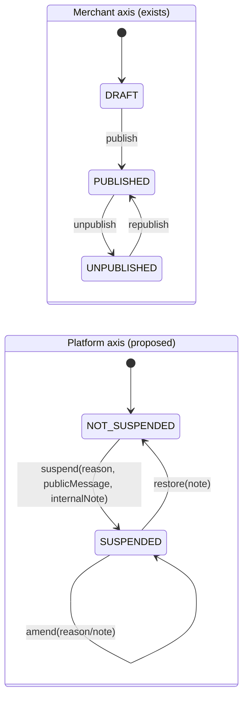
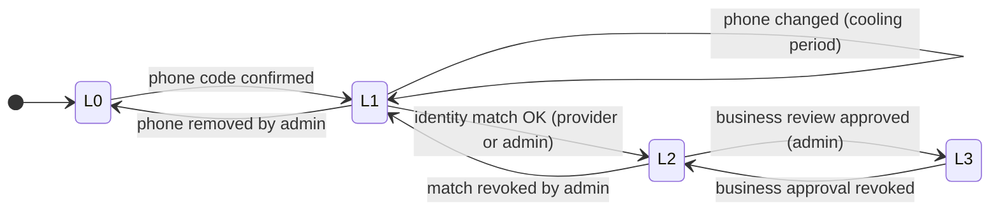
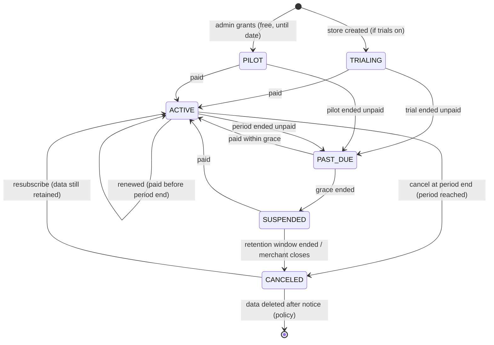

# ADR 0003 — Platform governance: store suspension, merchant verification, SaaS plans and billing

* **Status:** Proposed (design, 2026-11-24). **Amended 2026-11-24 with the owner's decisions (§0)**; phases G1 and G2 approved for
  implementation. Billing, verification, Torob and Emalls are not approved yet.
* **Context documents:** ADR 0002 §6 (phase 6 "platform business"), `docs/production/PRODUCTION_READINESS_CHECKLIST.md` (§K, §BL, §MO, §SEC,
  §G), `docs/commerce.md`, `docs/security.md`.
* **Labels used below:** **[EXISTS]** = in the code at commit `e44c982`; **[PROPOSED]** = this design; **[CONFIRM]** = legal or provider
  requirement not yet confirmed; **[DECIDE]** = owner decision needed.

---

## 0. Owner decisions and architecture correction (2026-11-24) — these override anything below

### 0.1 Decisions

| # | Question | Decision |
|---|---|---|
| D1 | Shopper access when a merchant unpublishes | **Yes.** Shoppers keep their existing orders, order details, payment status and tracking links (`/orders/<token>`, `/o/<token>`, signed-in "my orders") whatever the store's state. |
| D2 | Account-level restriction | **Not by default.** Suspension applies to one store; other stores of the same owner are unaffected. The design keeps room for a separate, explicit platform **account restriction** for serious abuse/fraud (not built in G2). |
| D3 | Admin deletion | **Soft deletion first** (not built in G2). Orders, payments, invoices and other legally relevant records are never permanently deleted outside an explicit retention policy that follows legal requirements. |
| D4 | Responses | Merchant API: **`403` with code `STORE_SUSPENDED`** for prohibited operations; viewing and managing existing orders stay available. Storefront: the same generic unavailable answer as any offline store, **no reason disclosed**. Private admin notes are never exposed to merchants or shoppers. |

### 0.2 Three independent conditions (replaces the single-status idea)

Availability is **computed** from three conditions that are stored separately and changed only by their own workflow. No workflow writes
another workflow's field.

| Condition | Stored as | Changed only by | Never changed by |
|---|---|---|---|
| **Publishing** (merchant) | `Store.status` + `publishedVersionId` [EXISTS] | Merchant publish / unpublish / republish | Admin suspension, billing |
| **Administrative suspension** (platform) | `Store.suspendedAt` + `StoreSuspension` rows [G2] | Platform admin suspend / restore | Merchant republish, payment |
| **Billing restriction** | Subscription state [future, B2] | Billing lifecycle job / payment settlement | Merchant republish, admin restore |

```
storefrontLive = published ∧ ¬adminSuspended ∧ ¬billingRestricted
newBusiness    = storefrontLive                       (cart, checkout, placing orders, OTP codes, payment-methods)
orderAccess    = store exists (always)                (order view, tracking links, my orders, payment return, shopper cancel)
prepaidActions = ¬adminSuspended                      (start a new online payment, send a card-to-card receipt, see the card numbers)
```

Consequences (each one is a test):
* Paying an overdue subscription clears only the billing restriction; an admin suspension stays.
* Merchant republish while suspended is refused (`403 STORE_SUSPENDED`), and even a published status never makes a suspended store live.
* Restoring a suspension does **not** publish an unpublished store and does **not** lift a billing restriction.
* Unpublishing (merchant) keeps `prepaidActions`: the merchant chose to close, but shoppers with pending card-to-card or online orders can
  still pay and the merchant still fulfils (D1). A suspension removes them (fraud risk: card numbers shown on our domain).
* An online payment **already started** is always verified on return (money may have moved); the reconciler is unchanged.

The rule lives in one pure function (`storeAvailability`) in `packages/shared`, used by the API gates; the billing input is fixed to
"not restricted" until billing exists.

### 0.3 Suspension is not content takedown

Product and store images are in a **public bucket**; suspending a store removes nothing from it and does not block direct image URLs.
Published snapshots and media rows are kept. Content takedown (media purge, provider-side deletion, evidence preservation) is a separate,
later capability; nothing in G1/G2 may assume suspension hides stored assets.

### 0.4 Implementation status (2026-11-24)
* **G1 done:** `resolveStoreForOrders` + `storeAvailability`; order links, `/o/` links, my orders, password sign-in, payment return and
  paying existing orders work on offline stores; order pages render in a neutral frame without the theme.
* **G2 done:** migration `20261203090000_g2_store_suspension` (`Store.suspendedAt`, `StoreSuspension`, `SuspensionReason`); public gates;
  `403 STORE_SUSPENDED` in `AccessService.resolve`; platform endpoints suspend / amend / restore / history; merchant `GET
  stores/:storeId/suspension`; audit rows on both sides; `/platform/stores` UI and the dashboard banner. The emergency path is a documented
  SQL procedure (docs/runbook.md), not a CLI.

**Independent review of G1/G2 (2026-11-24): no bypass of the gates found.** Fixed with tests:
* the store's own audit rows no longer carry the reason code or the operator (actor null, `{ byPlatform: true }` only); the platform's rows
  keep both;
* amending never erases evidence: the previous reason, message and note go into the platform audit row, and an omitted note keeps the
  current one;
* accepting an invitation to a suspended store is refused (`STORE_SUSPENDED`), the invitation stays valid for after a restore;
* suspension timestamps come from the database clock (`now()`, `GREATEST` on restore); an orphan open history row answers 409; the
  merchant banner reads `Store.suspendedAt`, the same field as every gate;
* no order SMS while a store is suspended (they carry the merchant-controlled store name);
* a busy store row (publish in progress) gives the admin a "retry" message.

**Accepted (documented, not fixed):**
* customers who only have SMS-code accounts cannot sign in on an offline store (codes cost SMS and must not reveal which phones have
  accounts); their order links and existing sessions keep working;
* order pages render the neutral frame with status 200 for any label (the API answers 404 for unknown orders; nothing store-specific
  leaks); existing offline stores answer 400/401 on customer sign-in where unknown labels answer 404 (subdomain existence is public anyway);
* the prepaid check lives in the order controllers (every current caller), not inside the payment services;
* a write already past the access check when a suspension lands still commits (it can never make the store live).

**Final verification (2026-11-24).**
* **Browser:** a Playwright run against the dev servers made 28 checks, all passing. It covered:
  * the `/platform/stores` list;
  * the suspend dialog, including validation and a server error;
  * history, both empty and filled;
  * the restore dialog, success, and a stale-page conflict;
  * the dashboard banner and a refused merchant write;
  * the store audit log, which shows no reason, note or operator;
  * the owner's other store;
  * shopper order pages on suspended and unpublished stores;
  * a 375 px mobile layout with RTL and no horizontal overflow.

  Defects found and fixed:
  1. The browser client did not rebuild domain errors from the `/api/v1` error shape. Every platform form (not only suspension) showed a
     generic message instead of field errors or conflicts. `client/http.ts` now reads both shapes; unit test added.
  2. The suspension dialog showed a class name for conflicts. It now builds the sentence from the error's reason.
  3. On a suspended store, the card-to-card panel had an empty heading. It now explains that the store takes no payments right now.
* **Migrations:**
  * Folder names in this repository carry one planned day per phase. Eleven are future-dated (up to `20261203090000`).
  * Prisma orders migrations only by name and applies them correctly.
  * The G2 migration was applied, rolled back and applied again on a clone of the dev database (12 stores, 32 orders), with no drift.
  * **Rule from now on:** a new migration's folder name must sort after the latest existing one. Do not use the name `prisma migrate dev`
    generates from today's clock. A probe showed that an earlier-named migration is applied LAST on existing databases but FIRST on fresh
    ones, so its order would differ between the two. Applied migrations are never renamed.
* **History after deletion:** the history rows and the platform audit rows survive store deletion and can still be fetched by store id.
  The suspension's platform audit row now also keeps the store's name, owner (id and username) and subdomain, so the history still
  identifies the merchant after the store row is gone.
* **E2E type check:** there were 6 errors (`FormData.entries`, iterating a `NodeListOf`). They existed before G2 (same 6 at `fd17051`).
  The cause was a missing `DOM.Iterable` lib in `apps/e2e/tsconfig.json`; fixed, now 0 errors. CI's `pnpm typecheck` does not include the
  e2e package. Recommended: add it.

### 0.5 Scope of the approved phase
G1: order access when a store is offline. G2: platform suspension with audit history, authorization and tenant-isolation tests.
Not in scope: billing, verification, account restriction, admin deletion, content takedown, emergency CLI (manual SQL procedure documented
instead; CLI later).

---

## 1. What exists today (inspected, not assumed)

| Area | Fact | Where |
|---|---|---|
| Store status | `StoreStatus = DRAFT \| PUBLISHED \| UNPUBLISHED`, changed **only by the merchant** through publishing | `schema.prisma`, `modules/publishing/repository.ts` |
| Public gate | Every public read resolves the store by subdomain with `status = 'PUBLISHED' AND publishedVersionId IS NOT NULL` in raw SQL (`resolveLiveStore`, `resolveProductRedirect`); checkout, cart, order placement, **the shopper's order page, payment return and the `/o/<token>` SMS link** all go through `CheckoutService.liveStoreId(label)` | `modules/publishing/public-read.ts`, `modules/checkout`, `modules/orders` |
| Storefront caching | Store pages, sitemap and robots answer `Cache-Control: no-store`; parsed snapshots are cached per immutable version id, but the live gate runs on every request | `apps/web/src/app/store-host/[label]`, `public-read.ts` |
| Merchant authorization | Every store route uses `StoreAccessGuard` → `AccessService.resolve(userId, storeId, permission)` with a fail-closed `@RequirePermission`; 16 permissions, roles OWNER / MANAGER / OPERATOR; `AuditInterceptor` writes `AuditEvent` after success | `modules/access`, `packages/shared/.../permissions.ts` |
| Platform operators | `PlatformAdmin` with a single role `SUPER_ADMIN`; `PlatformAdminGuard` reads the role from the DB on every request; first admin granted by a server command; platform actions go to `AuditEvent` with `storeId = null` | `modules/platform` |
| Platform admin screens | `GET platform/me, overview, stores, admins`; settings and write-only secrets | `platform.controllers.ts` |
| Merchant account | `User`: username + Argon2/password hash, `authVersion` (session revocation), deprecated `email`; **no phone, no verification, no recovery, no 2FA** | `schema.prisma` (ADR 0001 U1) |
| SMS / OTP | Kavenegar `verify/lookup` sender and an OTP domain (`OtpChallenge`) — **store-scoped** (`storeId` required, for shoppers only) | `platform/sms`, `modules/customers` |
| Limits | Global constants: 10 stores per user; per store 500 products, 50 categories, media count/bytes caps, 20 staff, 200 discount codes, 3 reserved subdomains; checked in each module's service | `products/service.ts`, `media/service.ts`, `categories/domain`, `access.service.ts`, `discounts.service.ts`, `publishing/subdomain.ts` |
| Customer payments | Zarinpal / Aghaye Pardakht adapters behind `PaymentGateway`; `Payment` rows are **store-scoped and order-bound**; claim → verify once under the order lock → reconciler job; the store's own terminal (store secret) | `modules/orders` |
| Platform money | A platform secret slot for the platform's own Zarinpal merchant id exists; **nothing uses it**. No plan, subscription, invoice or billing table | `packages/shared/.../platform/settings.ts` |
| Jobs | BullMQ on Valkey: outbox relay + handlers, and repeatable maintenance jobs (`upsertJobScheduler`) | `platform/queue`, `apps/api/src/worker` |

**Finding before any new feature:** because the shopper's order page, the payment return and `/o/<token>` use `liveStoreId`, a merchant who
**unpublishes** today also cuts shoppers off from their own orders, from card-to-card receipt upload and from the online payment return (the
reconciler still settles online payments in the background). Suspension would inherit the same flaw. Phase 1 below fixes the gate first.

---

## 2. Part A — Platform store suspension

### 2.1 Decision: an independent axis, not a fourth `StoreStatus`

| | Merchant unpublishing **[EXISTS]** | Platform suspension **[PROPOSED]** |
|---|---|---|
| Who | Merchant (`publish` permission) | Platform admin only |
| Purpose | Merchant's own choice (maintenance, closing) | Abuse, fraud, legal order, provider request, billing (separate cause, §4.6) |
| Reversible by merchant | Yes (republish) | **No** |
| Storefront | Offline | Offline |
| Merchant dashboard | Fully usable | Read-only except a small allowlist |
| Stored as | `Store.status` | `Store.suspendedAt` + `StoreSuspension` history |

Adding `SUSPENDED` to `StoreStatus` was rejected: publishing code writes `status` freely (`UNPUBLISHED`/`PUBLISHED`), restore would need the
previous status, and a merchant "republish" could clear it by accident. Two axes compose: **live = PUBLISHED ∧ not suspended ∧ billing
allows** (§4.6).

### 2.2 States and transitions



Store deletion: **blocked for the merchant while suspended** (evidence preservation); platform deletion is a separate, later decision **[DECIDE]**.

### 2.3 Reasons, notes and audit

* `reason` (enum): `FRAUD`, `PROHIBITED_GOODS`, `PHISHING_OR_IMPERSONATION`, `LEGAL_ORDER`, `PAYMENT_PROVIDER_REQUEST`, `CUSTOMER_COMPLAINTS`,
  `SECURITY_INCIDENT`, `OTHER`.
* `publicMessage` (≤ 300 chars, Persian): shown to the merchant in the dashboard. **Never** shown to shoppers.
* `internalNote` (≤ 2000 chars): platform admins only. **Must not** be written into `AuditEvent.metadata` with `storeId` set, because
  merchants with `audit.view` read that store's audit log.
* History row per suspension: `suspendedById`, `suspendedAt`, `reason`, notes, `liftedById`, `liftedAt`, `liftNote`. "Previous/new status" is
  implicit (suspended ↔ not suspended); the merchant `status` at suspension time is also stored for the record.
* `AuditEvent` gets two rows per action: platform row (`storeId = null`, full facts minus notes) and store row (`storeId` set, action
  `store.suspended` / `store.restored`, reason code only) so the merchant's log is truthful without exposing internal notes.

### 2.4 Who

* Today only `SUPER_ADMIN` exists. **[PROPOSED]** keep it for now; add a second role (`SUPPORT`, can suspend but not restore or manage
  secrets) only when there is more than one operator. A two-person rule is overkill at this size; the audit trail and the emergency
  procedure (2.7) are the controls.
* Merchants and staff can never suspend or restore.

### 2.5 Effects (single choke points, so it cannot be bypassed)

| Surface | Effect | Enforcement point |
|---|---|---|
| Storefront pages, sitemap, robots, product redirects | Neutral "store unavailable" page, `no-store`; **no reason disclosed** | `resolveLiveStore` / `resolveProductRedirect` SQL gain `AND s."suspendedAt" IS NULL` |
| Cart, checkout quote, order placement, OTP sign-in, customer accounts | Refused (same neutral error as an offline store) | `liveStoreId` ("new business" gate) |
| Existing shopper order page, `/o/<token>` | **Still visible** (status, items, notice "store unavailable; contact …") | New `orderAccessStoreId` gate (Phase 1) |
| Online payment return for an attempt started before suspension | **Still verified** (the money already moved; refusing it creates REFUND_REQUIRED chaos) | Same order-access gate; reconciler unchanged |
| Card-to-card pending orders | **Card numbers hidden, receipt upload refused**, orders left for the merchant/admin to cancel or confirm | Order view + receipt upload check suspension |
| Order SMS | Merchant notifications stop; shopper "cancelled/expired" messages still go; "placed" cannot happen | Notification handler reads availability |
| Merchant dashboard | Read-only. **Allowed:** `store.view`, `orders.view`, `orders.manage` (fulfil/cancel/refund existing orders), `customers.view`, `audit.view`. **Refused:** `publish`, `catalog.write`, `media.write`, `pages.write`, `theme.switch`, `store.settings`, `domain.manage` (no subdomain release/claim), `members.manage`, `secrets.manage` (no swapping card numbers/terminals), `discounts.manage`, `store.delete` | `AccessService.resolve` — one allowlist, every store route already passes through it |
| Store creation by the same account | **[DECIDE]** account-level restriction (§2.8) | `StoresService.create` |
| Public images | **Not removed**: the bucket is public, direct image URLs keep working. For illegal content a separate admin "purge media" action is needed **[PROPOSED, later]** | `modules/media` |
| Background jobs | Expiry, stock release, reconciler, rate repricing continue (they protect shoppers and stock) | worker |

**Bypass analysis:** all merchant writes go through API routes behind `StoreAccessGuard` (verify in Phase 2 with an architecture test that
no web Server Action writes to the database directly and every `stores/:storeId/*` controller uses the guard). Public reads go through
the two SQL gates plus `liveStoreId`; an architecture test should forbid new public resolvers that do not use them. There is no storefront
CDN cache today; if one is added later, suspension must purge it.

### 2.6 Data access

Orders, customers and receipts **remain stored and readable** by the merchant (read-only) and by platform admins. Nothing is deleted by a
suspension. Shoppers keep access to their own orders.

### 2.7 Emergency procedures

* **Suspend:** admin screen action (reason + public message + internal note). If the web UI or the admin account is unavailable: a server
  command `pnpm platform:suspend-store <storeId|label> --reason … --note …` (same pattern as `pnpm platform:admin`), audited with actor
  `null` + host user in metadata.
* **Restore:** admin action with a note; server command equivalent.
* **Platform-wide brakes [EXISTS]:** per-gateway platform switches (turn off Zarinpal/AP for all stores) and SMS switches.
* Effect is immediate (no cache); checklist item: rehearse on staging.

### 2.8 Account-level restriction **[DECIDE]**

A suspended merchant can register a new account or create another store under the same account (10 allowed). Proposal: `User.restrictedAt`
(+ reason) that blocks creating stores, publishing any store and accepting invitations; set optionally together with a store suspension.
Without merchant verification (Part B) a new account is trivial, which is why B-level L1 matters for abuse.

---

## 3. Part B — Merchant verification

> **Superseded by ADR 0005 (2026-11-24):** verification facts per subject instead of a level ladder; see `0005-merchant-verification.md`.

### 3.1 Levels (staged; each level is a fact, not a promise of legitimacy)

| Level | Meaning | How | Status |
|---|---|---|---|
| **L0 Registered** | Username + password | exists | [EXISTS] |
| **L1 Phone verified** | Owns an Iranian mobile | SMS code via the platform's Kavenegar account (reuse sender + OTP rules) | [PROPOSED] |
| **L2 Identity matched** | Legal name + national code, matched to the verified mobile | A mobile↔national-ID match service through a licensed provider ("Shahkar"-type) **[CONFIRM availability, cost, legal basis for us to call it]**; fallback: manual review | [PROPOSED, provider-dependent] |
| **L3 Business verified** | Legal entity / business licence / the merchant's own eNamad | Manual review by a platform admin of submitted facts (and documents only if **[CONFIRM]** required) | [PROPOSED, later] |

Email: the column is deprecated and no flow sends email; **no email verification** until a flow needs email (checklist O3). Revisit if
invoices must be emailed.

### 3.2 Capability matrix (proposal — every row is **[DECIDE]**, legal rows **[CONFIRM]**)

| Capability | Minimum level | Rationale |
|---|---|---|
| Build, preview, draft | L0 | Low risk; keeps onboarding friction low |
| Publish a store | **L1** | A reachable, rate-limited identity before anything is public |
| Cash on delivery orders, order SMS | L1 | Same |
| Card-to-card (merchant's card numbers shown to shoppers) | **L2** recommended | Highest scam risk on our domain: money goes straight to a personal card |
| Online gateway (merchant's own Zarinpal/AP terminal) | L1 platform-side | The PSP already identified the merchant **[CONFIRM: whether Zarinpal expects the store builder to verify too]** |
| Custom domain | L1 + domain ownership proof (checklist §K) | Domain verification is the real control |
| Paid subscription | L1; invoice details (legal name, national/economic code) collected at checkout if invoices require them **[CONFIRM]** | — |
| Staff invitations | L0 for the invitee, L1 for the owner | — |

**Existing stores:** grandfathered. On release, published stores stay live; owners get a dashboard banner and N days **[DECIDE]** to reach L1
before publishing again.

### 3.3 Account recovery (none today)

* With L1: "forgot password" by SMS code to the verified phone → new password → `authVersion + 1` (all sessions out).
* **SIM-swap / takeover risk is real** (an attacker who recovers an account can swap card numbers and terminals). Mitigations: after a
  recovery or phone change, `secrets.manage` and bank-card changes are **blocked for 48 h [DECIDE duration]**, an SMS goes to the old number
  when it changes, every step is audited.
* Phone change: current password + code on the new phone; old phone notified.
* Without a verified phone: recovery only by platform admin manual process **[DECIDE]** — high social-engineering risk; document it.

### 3.4 Abuse prevention

Rate limits (existing PostgreSQL limiter) on challenges per phone/IP/account; one verified phone per account and **[DECIDE]** at most N
accounts per phone; signup velocity per IP; account restriction (§2.8); verification level shown on the admin store list.

### 3.5 Privacy and retention

* Store the minimum: phone (E.164 `+989…`, same CHECK as customers), `phoneVerifiedAt`, level, `levelSetBy`, timestamps.
* L2: store **result + provider reference + national code**; national code is personal data — encrypt with the existing envelope scheme (as
  secrets) or store only a keyed hash if matching is all we need **[DECIDE]**.
* Documents (L3), if ever collected: private bucket (never the public image bucket), access by super admins only, audited, retention period
  **[CONFIRM legal retention]**, deletion on account closure unless retention is legally required.
* Verification data is **platform data**, never visible to store staff.



---

## 4. Part C — Plans, subscriptions and entitlements

### 4.1 Separation of money (non-negotiable)

| | Shopper → merchant **[EXISTS]** | Merchant → platform **[PROPOSED]** |
|---|---|---|
| Terminal | The store's own (store secret) | The platform's own (platform secret) |
| Tables | `Order`, `Payment` (store-scoped) | `Invoice`, `BillingPayment` (store-scoped for tenancy, but never joined to orders) |
| Callback | `https://<store>.<root>/checkout/payment/return…` | `https://<root>/billing/return/<gateway>` (platform host only) |
| Reconciler | orders reconciler | separate billing reconciler |
| Who sees it | merchant (orders.view) | owner only (new `billing.manage`) and platform admins |

The gateway **adapters** (HTTP clients) are shared: move `ZarinpalGateway` / Aghaye Pardakht adapter from `modules/orders/infrastructure`
to `apps/api/src/platform/gateways/` (code move, no behaviour change) so billing does not import the orders module.

### 4.2 Billing unit **[DECIDE]**

**Recommendation: one subscription per store.** It maps to tenancy, every limit is per store already, and "300 paying stores" is the goal.
The account-level cap (10 stores per user) stays as an anti-abuse ceiling. Trade-off: a merchant with three stores pays three times
(competitors do the same; revisit if agencies become a segment).

### 4.3 Plans and entitlements

* `Plan` rows are **immutable versions** (`code` + `version`): price per period, limits, features. Editing a plan creates a new version;
  subscriptions point at the version they bought, so price/limit changes never silently hit existing subscribers. Super admins manage plans
  in `/platform`.
* `limits` / `features` are JSON validated by one shared Zod schema (same pattern as platform settings), so adding a limit is a code change
  with a default, not a migration.
* **Entitlements** = `entitlementsFor(storeId)`: plan limits of the current subscription, capped by the platform ceilings (today's
  constants become ceilings). Enforcement points are the **existing** checks; they read the number from entitlements instead of the constant:

| Limit / feature | Existing check | Proposed key |
|---|---|---|
| Products | `products/service.ts` | `limits.products` |
| Categories | `categories/domain/category.ts` | `limits.categories` |
| Media count / bytes | `media/service.ts` | `limits.mediaCount`, `limits.mediaBytes` |
| Staff | `access.service.ts` | `limits.staff` |
| Discount codes | `discounts.service.ts` | `limits.discountCodes` |
| Order SMS per month | per-store monthly cap (3.6) | `limits.orderSmsPerMonth` (min with the platform cap) |
| Online gateways / card-to-card | payment availability | `features.onlinePayment`, `features.cardToCard` |
| Custom domain | not built | `features.customDomain`, `limits.customDomains` |
| Torob/Emalls feed | not built | `features.productFeeds` |
| Stores per account | `stores/service.ts` | stays an account ceiling (not a plan limit) |

* Usage is **counted on demand** inside the existing transactions (as today); no usage-counter table (avoids drift).
* **Over-limit after downgrade:** nothing is deleted or unpublished; creating more is refused until usage is under the limit; publishing a
  new version is allowed only when under the limit **[DECIDE]** (prevents "fill on trial, downgrade, keep everything" abuse while never
  breaking a live store).

### 4.4 Subscription lifecycle



* Transitions are made by **one scheduled job** (`billing.lifecycle`, e.g. every 15 min) and by payment settlement — never by request
  handlers reading the clock; each transition is idempotent (`UPDATE … WHERE state = expected`) and emits an outbox event (SMS reminders,
  audit).
* `SUSPENDED` here is **billing suspension**: same availability gate as §2.5 but a different cause, a different message ("subscription
  expired — renew") and the dashboard allows `billing.manage`. Never stored as a platform suspension (no abuse stigma, no admin needed to
  lift it: paying lifts it).
* Renewal: **manual prepaid periods** (1/3/6/12 months **[DECIDE]**) with SMS reminders (7 / 3 / 1 days before, at expiry). Automatic
  recurring charges are not assumed: Iranian direct-debit ("پرداخت مستقیم / پیمان") exists through some PSPs **[CONFIRM availability for us]**;
  design keeps it possible later.
* Upgrade: immediate; price = new plan price − **unused value of the current period** (integer, by days, rounded down in the merchant's
  favour). Downgrade: scheduled at period end. No mid-period refunds on downgrade.
* Cancel: `cancelAtPeriodEnd = true`; service continues to the end.

### 4.5 Payments, invoices, refunds

* `Invoice`: per store, sequential number **[CONFIRM numbering/tax rules]**, line items (plan version, period), `subtotal`, `taxAmount`
  (VAT rate **[CONFIRM]**), `total`, status `OPEN → PAID | VOID`, `REFUNDED` (manual). Buyer details snapshot (legal name, national or
  economic code, address) if required **[CONFIRM e-invoicing obligations (سامانه مودیان)]**.
* `BillingPayment`: one attempt per gateway request; `unique(gateway, authority)`; amount always taken from the invoice on the server.
* **Idempotent callback** (same proven pattern as orders): lock the attempt row → if already settled return the stored result → verify
  with the gateway (amount from the invoice) → in **one transaction** mark the attempt PAID, the invoice PAID and extend the subscription
  (`UPDATE … WHERE invoice.status = 'OPEN'`), emit `billing.paid` outbox event. A second callback, a reload or the reconciler finds it
  settled. A payment verified for an invoice that is no longer OPEN (voided, or already paid by another attempt) → `REFUND_REQUIRED` +
  alert, never a second extension.
* Billing reconciler job for attempts without a return (inquiry / verify, like orders).
* Refunds: manual (bank transfer or PSP panel), recorded on the invoice with actor and note; gateway `reverse` not implemented.

### 4.6 When a merchant stops paying (proposal; numbers **[DECIDE]**)

| Day | State | Storefront | Dashboard | Data |
|---|---|---|---|---|
| period end | PAST_DUE (grace 7 d) | live | banner + reminders | kept |
| +7 | SUSPENDED (billing) | neutral "unavailable" page; no new orders; existing order pages visible | read-only + billing + order fulfilment | kept |
| +90 | CANCELED | offline | billing + data export | kept; deletion notice sent |
| +N after notice | deleted | — | — | store data deleted **except records legally required [CONFIRM: retention of orders/financial records and shopper personal data]** |

Existing orders keep being fulfillable throughout (shopper protection). Shopper personal data retention after deletion must be confirmed
legally; the default proposal is to delete it with the store and keep platform invoices.

### 4.7 Backward compatibility

Migration backfills **every existing store** with a `PILOT` subscription on a `legacy` plan whose limits equal today's constants and whose
end date is **[DECIDE]** (or open-ended). Nothing changes for existing stores until an admin changes it.

---

## 5. Part D — Impact on the existing architecture

### 5.1 Models

| Capability | Existing models affected | New models / fields [PROPOSED] |
|---|---|---|
| Suspension | `Store` (+`suspendedAt`), `AuditEvent` (new actions), public-read SQL | `StoreSuspension`; `User.restrictedAt` (if 2.8 accepted) |
| Verification | `User` (+`phone`, `phoneVerifiedAt`, `verificationLevel`), `PlatformAdmin` (actor) | `AccountOtpChallenge` (not reusing store-scoped `OtpChallenge`, to keep shopper isolation CHECKs intact), `MerchantIdentity` (L2/L3) |
| Billing | `Store` (relation), `PlatformSecret` (existing slot) | `Plan`, `Subscription`, `Invoice`, `BillingPayment` |

### 5.2 Illustrative Prisma (not applied)

```prisma
enum SuspensionReason { FRAUD PROHIBITED_GOODS PHISHING_OR_IMPERSONATION LEGAL_ORDER PAYMENT_PROVIDER_REQUEST CUSTOMER_COMPLAINTS SECURITY_INCIDENT OTHER }

model Store {
  // ...existing fields...
  suspendedAt  DateTime?            // denormalised gate: NULL = not suspended (read by the public SQL and AccessService)
  suspensions  StoreSuspension[]
  subscription Subscription?
  invoices     Invoice[]
}

model StoreSuspension {
  id                 String           @id @default(cuid())
  storeId            String
  reason             SuspensionReason
  publicMessage      String           @db.VarChar(300)
  internalNote       String           @db.VarChar(2000)
  merchantStatusAtStart StoreStatus
  suspendedById      String?          // null = server command
  suspendedAt        DateTime         @default(now())
  liftedById         String?
  liftedAt           DateTime?
  liftNote           String?          @db.VarChar(2000)
  store              Store            @relation(fields: [storeId], references: [id], onDelete: Restrict) // evidence outlives deletion attempts
  @@index([storeId, suspendedAt])
  // migration SQL: UNIQUE (storeId) WHERE liftedAt IS NULL  -> at most one open suspension
  // CHECK: (liftedAt IS NULL) = (liftedById IS NULL AND liftNote IS NULL) or equivalent
}

enum VerificationLevel { L0 L1 L2 L3 }

model User {
  // ...existing fields...
  phone             String?            @db.VarChar(16) // +989xxxxxxxxx CHECK, unique among verified (partial unique index)
  phoneVerifiedAt   DateTime?
  verificationLevel VerificationLevel  @default(L0)
  restrictedAt      DateTime?
  sensitiveLockUntil DateTime?         // cooling period after recovery / phone change
}

model AccountOtpChallenge {
  id         String    @id @default(cuid())
  userId     String?   // null for recovery started by phone
  phone      String    @db.VarChar(16)
  purpose    String    @db.VarChar(16) // verify | recover | change
  codeHash   String    @db.VarChar(64)
  attempts   Int       @default(0)
  expiresAt  DateTime
  consumedAt DateTime?
  createdAt  DateTime  @default(now())
  @@index([phone, createdAt])
  @@index([expiresAt])
}

model MerchantIdentity {
  userId        String   @id
  legalName     String   @db.VarChar(120)
  nationalIdEnc Bytes    // envelope-encrypted (or a keyed hash) - [DECIDE]
  method        String   @db.VarChar(20) // provider | manual
  providerRef   String?  @db.VarChar(80)
  verifiedById  String?
  verifiedAt    DateTime
}

enum SubscriptionState { TRIALING PILOT ACTIVE PAST_DUE SUSPENDED CANCELED }

model Plan {
  id          String   @id @default(cuid())
  code        String   @db.VarChar(32)
  version     Int
  name        String   @db.VarChar(60)
  pricesToman Json     // { "1": 0, "3": 0, "12": 0 } months -> toman, validated by shared Zod
  limits      Json     // validated by shared Zod (§4.3)
  features    Json
  public      Boolean  @default(true)   // offered for self-serve purchase
  archivedAt  DateTime?
  createdAt   DateTime @default(now())
  @@unique([code, version])
}

model Subscription {
  storeId           String            @id
  planId            String
  state             SubscriptionState
  periodStart       DateTime
  periodEnd         DateTime          // trial/pilot end for TRIALING/PILOT
  graceEndsAt       DateTime?
  cancelAtPeriodEnd Boolean           @default(false)
  nextPlanId        String?           // scheduled downgrade
  updatedAt         DateTime          @updatedAt
  store             Store             @relation(fields: [storeId], references: [id], onDelete: Cascade)
  @@index([state, periodEnd])
}

enum InvoiceStatus { OPEN PAID VOID REFUNDED }

model Invoice {
  id          String        @id @default(cuid())
  storeId     String
  number      Int           // sequential, platform-wide - [CONFIRM rules]
  planId      String
  months      Int
  subtotal    BigInt
  taxAmount   BigInt
  total       BigInt        // CHECK total = subtotal + taxAmount, >= 0
  status      InvoiceStatus
  buyer       Json?         // snapshot of invoice details if required
  paidAt      DateTime?
  createdAt   DateTime      @default(now())
  store       Store         @relation(fields: [storeId], references: [id], onDelete: Restrict)
  payments    BillingPayment[]
  @@unique([number])
  @@index([storeId, createdAt])
}

model BillingPayment {
  id          String   @id @default(cuid())
  invoiceId   String
  gateway     String   @db.VarChar(20)
  authority   String   @db.VarChar(64)
  amountRial  BigInt
  status      String   @db.VarChar(20) // PENDING | PAID | FAILED | REFUND_REQUIRED
  refId       String?
  verifySentAt DateTime?
  createdAt   DateTime @default(now())
  settledAt   DateTime?
  invoice     Invoice  @relation(fields: [invoiceId], references: [id], onDelete: Restrict)
  @@unique([gateway, authority])
}
```

### 5.3 Tenant-isolation and authorization risks

| Risk | Mitigation |
|---|---|
| Internal suspension note leaks to merchants through the store audit log | Store-scoped audit row carries the reason code only (§2.3); test |
| A merchant route forgets the suspension allowlist | Enforced inside `AccessService.resolve` (one place); test that every permission outside the allowlist is refused while suspended |
| A new public resolver skips the gate | Architecture test: only `public-read.ts` / the two gates may resolve a store from a host label |
| Billing callback used to extend another store's subscription | Attempt → invoice → store bound in the DB; amount and store come from the invoice, never from the request; callback on the platform host only |
| Store staff see billing or verification data | New permission `billing.manage` (OWNER only); verification is per user, never exposed to staff |
| Platform admin over-reach (reads every store's data) | Already possible today; audit every platform read of store data **[PROPOSED]**; admin 2FA (checklist SEC3) |
| Downgrade/limit races | Limits checked in the same transactions/advisory locks the current constants use |

### 5.4 Background jobs

| Job | Capability | Interval |
|---|---|---|
| `billing.lifecycle` (trial/pilot end, period end → PAST_DUE, grace → SUSPENDED, retention → CANCELED, scheduled downgrades) | Billing | 15 min |
| `billing.reconcile` (unreturned attempts) | Billing | 5 min |
| `billing.reminders` (outbox → SMS) | Billing | event-driven |
| `account-otp.cleanup` | Verification | with `db:cleanup` |
| `verification.grace` (grandfathered stores past deadline → banner/state) | Verification | daily |
| none new | Suspension (synchronous) | — |

### 5.5 API and UI

See §6. UI: `/platform/stores/<id>` detail (suspension, verification, subscription), plan editor, subscription list with filters; merchant
dashboard banners (suspended / past due / verify your phone), `/dashboard/account/verification`, `/dashboard/stores/<id>/billing`
(plans, pay, invoices), "forgot password" page; storefront neutral unavailable page.

### 5.6 Migration and compatibility concerns

* All migrations expand-only, with CHECKs and `down.sql`, drilled up/down/up (project convention).
* `Store.suspendedAt` nullable → no backfill. Public SQL changes are additive conditions.
* `User.phone` nullable; partial unique index on verified phones.
* Billing backfill: one `legacy` plan + `PILOT` subscription per existing store in the same migration (data migration, idempotent).
* Replacing constants with entitlements: constants stay as ceilings; with the legacy plan the numbers are identical → no behaviour change
  at release.
* OpenAPI regenerated; new domain errors registered (`StoreSuspendedError` 423 or 403 **[DECIDE status code]**, `VerificationRequiredError`
  403 with the required level, `PlanLimitError` 409, `SubscriptionInactiveError` 402).

---

## 6. API proposal

All under `/api/v1`. Platform routes: `SessionGuard + PlatformAdminGuard`, audited. Store routes: `StoreAccessGuard` with a permission.

| Method | Path | Who | Purpose |
|---|---|---|---|
| GET | `/platform/stores?suspended=&state=&level=` | admin | Extend existing list with suspension, verification, subscription |
| GET | `/platform/stores/:storeId` | admin | Detail incl. suspension history, owner level, subscription, invoices |
| POST | `/platform/stores/:storeId/suspend` | admin | `{reason, publicMessage, internalNote}` |
| POST | `/platform/stores/:storeId/suspension/amend` | admin | Update reason/notes of the open suspension |
| POST | `/platform/stores/:storeId/restore` | admin | `{note}` |
| POST | `/platform/users/:userId/restrict` / `unrestrict` | admin | Account restriction (§2.8) |
| GET | `/platform/users/:userId/verification` | admin | Level, phone (masked), identity result |
| POST | `/platform/users/:userId/verification` | admin | `{level, note}` manual L2/L3 decision or revocation |
| GET / POST | `/platform/plans` | admin | List / create a plan version |
| POST | `/platform/plans/:planId/archive` | admin | Stop offering |
| POST | `/platform/stores/:storeId/subscription/pilot` | admin | `{planId, until, note}` |
| POST | `/platform/stores/:storeId/subscription/extend` | admin | `{until, note}` (goodwill) |
| POST | `/platform/invoices/:invoiceId/void` / `refund` | admin | `{note}` |
| GET | `/me/verification` | merchant | Own level, masked phone, what each level unlocks |
| POST | `/me/phone/challenge` · `/me/phone/verify` | merchant | L1 (rate limited) |
| POST | `/auth/recovery/challenge` · `/auth/recovery/reset` | anyone | SMS recovery (same answer whether the account exists) |
| GET | `/stores/:storeId/availability` | `store.view` | Banner facts: suspended (public message), billing state |
| GET | `/stores/:storeId/entitlements` | `store.view` | Limits and usage |
| GET | `/stores/:storeId/subscription` | `billing.manage` | Current plan, period, state |
| GET | `/billing/plans` | merchant | Public plans |
| POST | `/stores/:storeId/subscription/checkout` | `billing.manage` | `{planId, months}` → invoice + `{payUrl}` |
| POST | `/stores/:storeId/subscription/cancel` | `billing.manage` | Cancel at period end |
| GET | `/billing/return/:gateway` | browser (platform host) | Callback → verify → redirect to the billing page |
| GET | `/stores/:storeId/invoices[/ :invoiceId]` | `billing.manage` | Invoices |

---

## 7. Part E — Implementation roadmap (dependency-aware)

| Phase | Content | Migration | Tests | Security focus | Acceptance |
|---|---|---|---|---|---|
| **G1 Availability gate** | One `storeAvailability` concept; split `liveStoreId` into *new business* vs *existing order access*; shoppers keep order page, payment return and `/o/` links when a store is offline; card numbers hidden and receipts refused when offline **[DECIDE: apply to merchant unpublish too]** | none | unit (gate), DB (unpublished store: order page OK, checkout refused, payment return verified), E2E (unpublish → order link) | No new public resolver; card numbers not exposed | All existing tests green; new tests prove the split |
| **G2 Platform suspension** | `Store.suspendedAt`, `StoreSuspension`, admin endpoints + screen, dashboard banner, allowlist in `AccessService.resolve`, store deletion blocked, server command, audit split | 1 (expand) + drill | unit (allowlist), authorization (every permission refused/allowed while suspended, staff roles, non-admin 404), DB (public SQL, concurrent suspend/publish), E2E (suspend → storefront unavailable, order page visible, restore) | Internal note never in store audit; no bypass via publish/subdomain/secrets/delete | Suspend and restore take effect on the next request; audited both sides |
| **V1 Phone verification + recovery** | `User.phone…`, `AccountOtpChallenge`, challenge/verify, recovery, cooling period, publish requires L1 (grandfather) | 1 | unit (OTP rules), DB (limits, recovery bumps `authVersion`), authorization (cooling period blocks `secrets.manage`), E2E (verify, recover) | SIM-swap mitigations, enumeration-safe answers, rate limits | A merchant verifies, recovers, cannot change secrets for 48 h after recovery |
| **B1 Entitlements (no money)** | `Plan`, `Subscription`, legacy plan + PILOT backfill, `entitlementsFor`, constants → ceilings, admin pilot grant, usage page | 1 (+ data backfill) | unit (entitlement math), DB (each limit from the plan; downgrade over-limit refuses create only), authorization (`billing.manage` owner only) | Limits enforced in the same locks as today | Behaviour identical for existing stores; a smaller plan limits a test store |
| **B2 Lifecycle without payment** | `billing.lifecycle` job, PAST_DUE/grace/billing suspension through the G1 gate, reminders via outbox → SMS, admin extend | 0–1 | job idempotency, clock-driven transitions, E2E (pilot ends → grace → unavailable → admin extends → live) | Job double-run safe | Transitions only by job/settlement, each audited |
| **B3 Subscription payments** | Move gateway adapters to `platform/gateways`, `Invoice`, `BillingPayment`, checkout, callback, reconciler, invoices page | 1 | fake gateway (existing fakes), double callback, callback + reconciler race, voided invoice → REFUND_REQUIRED, amount tamper, other-store invoice | Idempotency, platform-host callback only, amount from invoice | Sandbox payment extends exactly once |
| **B4 Upgrade/downgrade, cancel, refunds, invoice format** | Proration, scheduled downgrade, cancel at period end, manual refund, legal invoice fields | 0–1 | unit (proration), DB | — | Per legal confirmation |
| **V2 Identity (L2/L3)** | Provider or manual review, `MerchantIdentity`, card-to-card gate | 1 | provider fake | Encryption of national code, admin-only access | After provider/legal confirmation |

**Dependencies:** G1 → G2; G1 → B2; V1 independent (needs Kavenegar for real use, dev log otherwise); B1 → B2 → B3 → B4; V2 after legal.

### Gates

| Milestone | Required | Recommended |
|---|---|---|
| **1. Internal staging** | none of these (staging has no real merchants) | G1 |
| **2. First real merchant** (pilot, free) | G1, G2, V1 | B1 (legacy plan + pilot record, so limits and dates are explicit) |
| **3. Public launch** (open registration) | G1, G2, V1, B1, B2 (trial/pilot expiry must work), account restriction (§2.8) if accepted, admin 2FA (checklist SEC3) | V2 for card-to-card if the owner accepts §3.2 |
| **4. Paid subscription launch** | B3, B4, invoice/tax confirmations, platform terminal live, refund procedure | billing alerts (checklist MON1) |

---

## 8. Design risks and trade-offs (critical view)

1. **Suspension is not content removal.** Public images stay reachable by direct URL; an illegal-content case needs a separate media purge
   and possibly provider-side deletion. Do not promise "removed" when the store is only suspended.
2. **Showing card numbers is the biggest fraud vector.** Card-to-card sends money straight to a personal card shown on our domain. Gating it
   behind L2 adds friction exactly where competitors make it easy; the alternative is accepting the risk with fast suspension.
3. **Phone verification is weak identity** (cheap SIMs, SIM swap). It reduces drive-by abuse and enables recovery; it is not KYC. The
   recovery path also creates a takeover path — hence the cooling period.
4. **Shahkar-type checks** may not be legally available to us or may require a licence/contract **[CONFIRM]**; do not design product
   promises around them.
5. **Per-store billing** is simple but may annoy multi-store merchants; switching to per-account later would be a data migration.
6. **No automatic renewal** in Iran means churn at every period end; reminders and long prepaid periods are the practical answer.
7. **Immutable plan versions** add a little complexity but avoid legal and support disputes about changed terms; recommended.
8. **Billing suspension vs platform suspension** share the gate but must never share messages, permissions or records.
9. **Grace periods cost money** (hosting, SMS) and create disputes; numbers are business decisions.
10. **Deleting data after cancellation** conflicts with possible legal retention of financial records; until confirmed, the safe default is
    *retain and restrict*, which has storage cost and privacy risk.
11. **Overengineering guard:** no generic "entitlement engine", no usage-counter tables, no role/permission DSL for platform staff, no
    multi-currency, no coupons for subscriptions until asked.

## 9. Decisions needed from the owner

**Product**
1. Suspension effects on merchant unpublish (G1): should shoppers always keep order access when a merchant unpublishes? (Recommended: yes.)
2. Account-level restriction (§2.8): yes/no.
3. Platform deletion of a suspended store: allowed? after how long?
4. Verification matrix (§3.2), especially L2 for card-to-card, and the grandfather period for existing stores.
5. Recovery without a verified phone: allowed by admin or not.
6. Cooling period length after recovery/phone change.
7. Billing unit: per store (recommended) or per account.
8. Plans: names, prices, periods (1/3/6/12 months), limits, features, trial length or none, free plan or not.
9. Grace and retention numbers (§4.6).
10. Over-limit after downgrade: refuse new publishes or only new items.
11. Legacy/pilot end date for existing stores.
12. HTTP status for suspended stores' merchant API (403 vs 423) and the storefront page wording.

**Legal [CONFIRM]**
13. Whether identity documents or a mobile↔national-ID match are required for merchants of a store builder, and who may call such services.
14. VAT, invoice numbering and e-invoicing (سامانه مودیان) obligations for subscription invoices.
15. Retention period for orders, invoices and shopper personal data after a store is closed.
16. Takedown obligations (who can order a suspension, response times).

**Providers [CONFIRM]**
17. Zarinpal / Aghaye Pardakht: platform terminal for subscriptions; callback domain rules; direct-debit availability; whether the store
    builder must verify merchants who connect their own terminals.
18. Kavenegar: templates for merchant OTP, recovery and billing reminders (new templates to approve).
19. eNamad: whether merchants on our subdomains need their own eNamad for their terminals (ties to custom domains).

## 10. Recommendation for the next implementation phase

**G1 + G2: availability gate and platform store suspension.** It needs no external provider, no legal confirmation and no product
pricing; it fixes an existing shopper-facing flaw (order access when a store goes offline); it is required before the first real merchant;
and both billing suspension (B2) and verification gates reuse the same choke points. It should not start before the owner answers
decisions 1, 2, 3 and 12.
