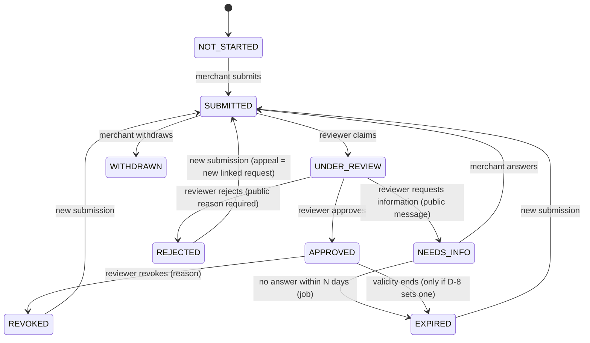
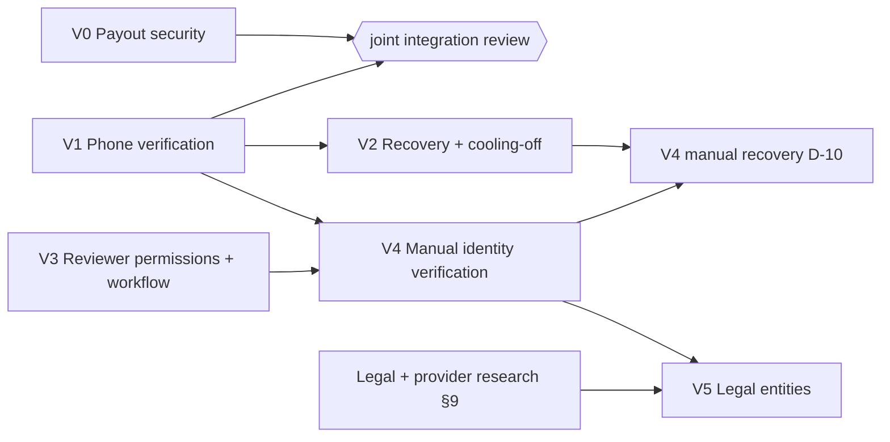

# ADR 0005 — Merchant verification and account trust

* **Status:** Accepted as architecture, 2026-11-24, with the owner's decisions of the same day (§0). **Nothing in this document is
  implemented**; no schema, API, UI or test exists for it. Every database or API change below is an expectation for future work.
* **Supersedes:** ADR 0003 Part B. ADR 0003 Parts A (suspension, implemented) and C (billing) are unchanged.
* **Preserves (unchanged):** ADR 0004 — Kavenegar is activated only in the final production deployment phase; development OTP is
  log-only and refused outside development/test; production never accepts fixed or development codes; real SMS delivery testing is
  deferred to production provider configuration.
* **Labels:** **[EXISTS]** verified in code · **[PARTIAL]** · **[MISSING]** · decision status **Approved** (owner) / **Recommended**
  (architect, needs owner confirmation) / **Pending** (open). External-claim status: **Confirmed** / **Public, confirm for our use** /
  **Unverified assumption** / **Needs provider or legal consultation**.
* **External research:** none was performed. No statement about an Iranian provider or regulation is marked "Confirmed".

---

## 0. Decision register

### 0.1 Approved by the owner (2026-11-24)

| ID | Decision | Consequence in this ADR |
|---|---|---|
| **D-13** | **Grace period for existing stores.** Existing stores never go offline and receive no automatic restriction because their owners have not verified; the grace period is for notices and reminders only. This is **not** a permanent exemption: any future enforcement for existing merchants is a separate product decision (D-17). | §11; V1 builds verification without enforcing it on existing stores |
| **D-10** | **Identity-based manual recovery.** A merchant who lost access to the verified phone may request manual recovery, available **only to identity-verified users**, through a controlled administrative review. Success invalidates every session and notifies the owner through the available verified channels. Users who are **not** identity-verified have **no** manual recovery path and no alternative method (§6.3). | V2 builds self-service recovery; the manual path ships with V4 |
| **D-6** | **Encrypted PostgreSQL storage** for identity documents in the initial implementation; **no private S3 bucket in this phase**. | §6.4 requirements; V4 |
| **D-15** | **V0 (payout security) and V1 (merchant phone verification) proceed in parallel**, with an explicit integration review **before either is considered complete**; V2 depends on V1. *(First labelled "D-14" by the owner; the original D-14 is a different question and stays Pending — see §0.4.)* | §14, §15.7 |
| **D-3** | **Only the store OWNER may change payout settings** — bank cards and payment-gateway credentials (merchant id / pin). MANAGER and OPERATOR may not. *(Approved in the security-review round, 2026-11-24.)* | §6.2, §15 V0-1 |
| **D-2** | **Cooling-off of 24 hours** after account recovery or a merchant phone-number change. Restricted operations: D-2s. | §6.3, §16.1.5 |
| **D-2a** | **Only an authorised SUPER_ADMIN may lift a cooling-off early**; the action requires a reason and produces an immutable audit record. | §15.3, §16.1.7 |
| **D-12** | **A phone-number change invalidates all other active sessions**; the current session is handled safely according to the authentication design (§15.4); the previously verified phone is notified where possible. | §15.4 |
| **D-12c** | **The current session survives a phone change**: all other sessions are revoked, the current session's credential is re-issued in the same response and stays valid after the change. *(Final round, 2026-11-24.)* | §16.2.6 |
| **D-4** | **A verified phone belongs to at most one merchant account**, enforced by a database constraint over verified phones only (pending numbers are not reserved); numbers normalised before storage and comparison; no enumeration through registration, verification or phone-change answers. | §16.2.2 |
| **D-11** | **Merchant OTP has its own development-only flag**, separate from the shopper flag; refused at start-up outside development/test; no fixed code, master code, bypass or predictable fallback; sender stays provider-independent. | §16.2.3 |
| **D-19** | **Production refuses payment sandbox mode** at the API and at the configuration boundary (not only in the UI); rejected attempts audited; tested. | §16.1.6 |
| **D-20** | **SUPER_ADMIN re-enters the password before an early cooling-off lift**; reason required; atomic audit with before/after; merchant notified; platform security alert. Password re-entry is **not** MFA and not phishing-resistant (§16.3). | §16.1.7 |
| **D-2s** | **Cooling-off blocks exactly:** payout settings (bank cards, gateway credentials) and verified-phone changes. **Stays available:** password change, sign out everywhere, and every ordinary operation. | §16.1.5 |
| **D-22** (finding V0-6) | **Only the store OWNER receives full bank-card numbers** in merchant APIs; MANAGER and OPERATOR get masked values (last 4) from the backend. The one business exception: shoppers see the store's card numbers on their own unpaid card-to-card orders (existing, hidden while the store is suspended). | §16.1.2 |

### 0.2 Recommended (architect; needs explicit owner confirmation)

*All earlier recommendations (D-2s, D-3, D-4, D-11, D-12c, D-19, D-20) are now Approved (§0.1). New recommendations from §16:*

| ID | Recommendation | Status |
|---|---|---|
| D-23 | Staging may use the gateway sandbox only through an explicit server environment flag (`PAYMENT_SANDBOX_ALLOWED=true`) that must never be set on production; see the conflict in §16.4-2 | Recommended — confirm |
| D-24 | Repeated cooling-off triggers **restart** the 24 h from the latest trigger and never shorten an existing period | Recommended — confirm |
| D-25 | Security events (refused payout attempts, lift attempts) visible to the store OWNER and platform admins, not to MANAGER | Recommended — confirm |

### 0.3 Pending (owner decision required)

| ID | Question | Recommendation | Status |
|---|---|---|---|
| **D-1** | Does card-to-card require identity verification? | Yes by public launch; pilot: no gate, manual identity on request | **Pending** |
| **D-5** | Reviewer permissions (and four-eyes for revocations / manual recovery) | Permissions required before any real document is stored; four-eyes for manual recovery | **Pending** |
| D-7 | National code: HMAC only, or also encrypted clear value | HMAC + last 3 digits; encrypted clear value only if a provider re-check or invoices need it | **Pending** |
| D-8 | Identity validity period / periodic re-check | None at launch; revoke on evidence | **Pending** |
| **D-9** | Document retention after a decision | 90 days, subject to legal confirmation; see §6.4 for the backup window | **Pending** (legal input) |
| D-14 | Verified merchant phone replaces `StoreSmsSetting.merchantPhone`? | Default from it; keep the per-store override | **Pending** |
| **D-16** | Onboarding policy for **new** merchants: does publishing require a verified phone? | Yes (phone verification is cheap and gives reachability); enforcement behind a platform switch, off until approved | **Pending** |
| **D-17** | Future enforcement for **existing** merchants after the grace period | Separate decision when V1 data shows adoption; never automatic offline | **Pending** |
| D-18 | Manual recovery when the old phone is lost: which "verified channels" receive the notice | Old phone (if reachable), the newly verified phone, an in-app notice; no email (none exists) | **Pending** |
| D-21 | Separate master-key id for identity documents (not shared with payment credentials) | Yes | **Pending** |

### 0.4 Inconsistencies found while updating

1. The owner's "D-14 — implementation priority" does not match the original D-14 (merchant notification phone). Recorded as **D-15**;
   the original D-14 stays Pending.
2. D-10 requires identity verification, which only exists after **V4**; V2 depends only on V1. Until V4 ships **no merchant can be
   recovered manually**: a merchant who loses both the phone and the password is unrecoverable (§6.3).
3. D-10 asks to notify "through available verified contact channels", but the platform has **no email** (removed in ADR 0001 U1); the
   only verified channel is the phone that was lost. D-18 decides the notice channels.
4. The original phase list had V6 (provider identity). The approved list ends at V5; provider-based identity is now an optional
   extension of V4, gated by §9 research.
5. The original matrix said "publishing requires phone verified". With D-13 this cannot apply to existing stores; for new merchants it is
   D-16 (Pending).

---

## 1. Executive summary

1. **Independent verification facts, not a ladder.** Phone ownership (account), identity (person) and business status (legal entity)
   are different facts about different subjects. Display levels are derived names only.
2. **Phone verification on `User`; identity per `User` in its own record; business on a separate `LegalEntity`** that a verified
   person represents and that can be linked to several stores. One identity verification covers all of a user's stores.
3. **Store capabilities derive from the store OWNER's facts** through one pure function, like `storeAvailability` (ADR 0003).
4. **Verification, store suspension, billing restriction and account restriction are independent records with independent writers.**
   Approving a merchant never restores a suspended store; restoring a store never approves its owner.
5. **Order of work:** V0 payout security ∥ V1 phone verification → V2 recovery and cooling-off → V3 reviewer permissions and workflow
   → V4 manual identity verification (documents encrypted in PostgreSQL) → V5 legal entities (after legal and provider research).
6. **Existing stores** keep working through a reminder-only grace period (D-13). **New-merchant enforcement** is a separate pending
   decision (D-16).

---

## 2. Current architecture assessment (verified in code at commit `c97e302`)

| Area | Status | Facts |
|---|---|---|
| User model | [EXISTS] | `User`: `username` (unique), `name`, `passwordHash` (Argon2), `authVersion`; `email` **deprecated** (U1, unused) |
| Registration / login | [EXISTS] | `/api/auth/register`, `/login`, `/logout`, `/logout-all`, `/me`, `/change-password`; rate limits per IP and per username |
| Sessions | [EXISTS] | Signed cookie token, 7-day max age; an `authVersion` bump revokes every token |
| Password reset / recovery | [MISSING] | `PasswordResetToken` is deprecated (email reset removed); no recovery path |
| Merchant phone | [MISSING] / [PARTIAL] | No phone on `User`; `StoreSmsSetting.merchantPhone` is a per-store, **unverified** notification number |
| Phone change, two-factor auth, ownership transfer | [MISSING] | — |
| OTP | [EXISTS], shopper-only | `OtpChallenge` (required `storeId`), random 6-digit codes, HMAC-stored, attempts/expiry, rate limits; `OtpSender` port; `CUSTOMER_OTP_DEV_LOG` refused outside development/test (tested) |
| SMS abstraction | [EXISTS] | `OtpSender`, `TemplateSender`; Kavenegar adapter from platform settings + encrypted platform secret (ADR 0004) |
| Multi-store / staff | [EXISTS] | `Store.ownerId`, ≤ 10 stores per user, `StoreMember` MANAGER / OPERATOR |
| Payout-sensitive permissions | [EXISTS] | Bank cards: `PUT /stores/:id/bank-cards` requires `store.settings` (**OWNER and MANAGER**). Gateway credentials: store secrets require `secrets.manage` (**OWNER only**). Neither change is notified or delayed |
| Platform roles / UI | [EXISTS], coarse | Single `SUPER_ADMIN`; `/platform` overview, stores (suspension), settings, rates, admins |
| Audit | [EXISTS] | `AuditEvent` (platform rows `storeId` null; store rows visible to OWNER/MANAGER), 365-day retention |
| Suspension | [EXISTS] | ADR 0003 G2; computed availability |
| Secrets encryption | [EXISTS] | Envelope encryption: AES-256-GCM data key wrapped by `SECRETS_MASTER_KEYS` (env, **not** in the database); `pnpm secrets:rotate` |
| Private binary in PostgreSQL | [EXISTS] precedent | Card-to-card receipt images: re-encoded (EXIF stripped), `bytea`, served only by an authorised route — **not** encrypted at the application level |
| Object storage | [EXISTS], public only | One public-read bucket; no private read API (not used for documents, D-6) |
| Backups | [EXISTS] (scripts) | `pg_dump` daily-capable script, 14-day `RETENTION_DAYS`, off-server copy mandatory (runbook) |
| Verification of identity / business | [MISSING] | — |

---

## 3. Verification model

| Fact | Subject | Established by | Lifetime |
|---|---|---|---|
| Phone verified | `User` | OTP to the phone (V1) | Until the phone changes or a reviewer removes it |
| Identity verified | `User` (person) | Manual document review (V4); provider methods later if §9 allows | Until revoked (D-8) |
| Business verified | `LegalEntity` | Manual review (V5) | Until revoked or the entity's data changes |

Derived display levels: **L0** registered · **L1** phone verified · **L2** identity verified (implies L1 at the time of approval) ·
**business verified** is a badge on a legal entity, not a level. A phone change does **not** revoke a manual (document-based) identity
proof; it does revoke a future phone-bound provider proof.

---

## 4. Conceptual data model (illustrative only — not added to the repository)

```prisma
model User {                                 // V1, V2
  // ...existing
  phone              String?   @db.VarChar(16)   // +989xxxxxxxxx
  phoneVerifiedAt    DateTime?
  sensitiveLockUntil DateTime?                    // V2 cooling-off
  // partial unique index on (phone) WHERE phoneVerifiedAt IS NOT NULL (D-4)
}

model AccountOtpChallenge {                  // V1 (purposes VERIFY_PHONE, CHANGE_PHONE), V2 (RECOVER)
  id String @id @default(cuid()); userId String?; phone String @db.VarChar(16)
  purpose AccountOtpPurpose; codeHash String @db.VarChar(64); attempts Int @default(0)
  expiresAt DateTime; consumedAt DateTime?; createdAt DateTime @default(now())
}                                             // separate from the shopper OtpChallenge (store-scoped isolation)

model PayoutChange {                         // V0 (or AuditEvent rows with a fixed action set; see §14 V0)
  id String @id @default(cuid()); storeId String; actorId String
  kind String  // BANK_CARDS | GATEWAY_CREDENTIAL
  summary Json // masked: last 4 digits / gateway name only, never full values
  createdAt DateTime @default(now())
}

model IdentityVerification {                 // V4
  id String @id @default(cuid()); userId String; status VerificationStatus
  method IdentityMethod                      // MANUAL_DOCUMENTS (V4); PROVIDER_* only after §9
  legalName String @db.VarChar(120); nationalIdHmac String @db.VarChar(64); nationalIdEnc Bytes? // D-7
  decidedById String?; decidedAt DateTime?; createdAt DateTime @default(now())
  // partial unique: one open request per user; one APPROVED per user
}

model VerificationDocument {                 // V4 (D-6: encrypted in PostgreSQL)
  id String @id @default(cuid()); verificationId String; kind String  // allowlist
  keyId String @db.VarChar(32); wrappedKey Bytes; sealed Bytes        // envelope ciphertext of the re-encoded image
  mime String @db.VarChar(20); sizeBytes Int; sha256 String @db.VarChar(64)
  deleteAfter DateTime?; deletedAt DateTime?; createdAt DateTime @default(now())
}

model VerificationEvent {                    // V3/V4: append-only history
  id String @id @default(cuid()); subjectType String; subjectId String
  fromStatus VerificationStatus?; toStatus VerificationStatus
  actorId String?; actorKind String; publicReason String?; internalNote String?; createdAt DateTime @default(now())
}

model RecoveryRequest {                      // V4 (D-10 manual recovery), uses the same workflow states
  id String @id @default(cuid()); userId String; status VerificationStatus
  newPhone String @db.VarChar(16); evidenceVerificationId String?  // documents compared with the approved identity
  createdAt DateTime @default(now())
}

model LegalEntity {                          // V5
  id String @id @default(cuid()); representativeId String; legalName String @db.VarChar(200)
  nationalIdEnc Bytes; nationalIdHmac String @db.VarChar(64); registrationNo String?; status VerificationStatus
}
model Store { /* ...existing */ legalEntityId String? }   // V5, optional
```

* One user, many stores: identity and legal entities are shared.
* Many users, one store: only the **owner's** facts drive capabilities; staff facts never widen them.
* Ownership transfer is not implemented; when it is, capabilities are recomputed from the new owner, payout settings are cleared or
  frozen until the new owner re-confirms them, and `legalEntityId` is cleared unless the new owner represents that entity.

---

## 5. Workflow and state transitions

Phone verification is an OTP proof (no review). Identity, legal-entity and manual-recovery requests share one state machine:



* Merchant: submit, answer, withdraw — own subject only. Reviewer (V3 permission): claim, approve, reject, request information, revoke.
  System: expiry jobs. Compare-and-set transitions; one `VerificationEvent` per transition in the same transaction.
* One open request per subject; duplicates return the open request; resubmissions rate-limited (e.g. 3 per 30 days).
* A reviewer can never act on a request about themself or about a user of a store they belong to (server-side, tested).

---

## 6. Security and privacy

### 6.1 Merchant OTP on the existing architecture (V1, ADR 0004 preserved)

* Reuse the OTP **domain rules and crypto** (random 6-digit code, HMAC storage, attempts, expiry, rate limits) and the **`OtpSender`
  port**; move the port to the platform SMS layer (code move) so customer and account OTP do not depend on each other.
* **Separate table** `AccountOtpChallenge`; the shopper `OtpChallenge` and its store isolation are untouched.
* Development delivery only through a development-only flag refused outside development/test, with a start-up test (D-11). No fixed
  codes, no bypass, no environment-based skip. Kavenegar templates for account codes are configured only at deployment (ADR 0004).

### 6.2 Payout security (V0)

* **Payout settings** are a distinct category from ordinary store settings: bank cards (card-to-card destinations) and gateway payout
  credentials (Zarinpal merchant id, Aghaye Pardakht pin). They decide **where shoppers' money goes**. Ordinary settings (name, colours,
  contact, shipping) do not.
* Required regardless of D-3: an audit row for every payout change (actor, store, kind, masked summary — last 4 digits / gateway name,
  never full values), and an owner notice (in-app now; SMS when V1 provides a verified phone and the provider is live at deployment).
* With D-3 (**Approved**): a dedicated permission (e.g. `payout.manage`, OWNER only) replaces `store.settings` on the bank-card route;
  MANAGER keeps ordinary settings.
* Payout changes are refused while the platform suspends the store (already true: G2 refuses all non-order writes).

### 6.3 Account recovery and cooling-off (V2; manual path V4)

| Situation | Behaviour |
|---|---|
| Forgot password, has the verified phone | Self-service (V2): OTP to the verified phone → new password → `authVersion + 1` (all sessions end) → cooling-off starts (D-2) → notice to the phone |
| Phone change while signed in | Current password + OTP to the new phone → notice to the old phone → other sessions end (D-12) → cooling-off starts |
| Lost the phone, **identity-verified** (D-10) | Manual recovery request (V4): new phone verified by OTP, documents compared by a reviewer with the approved identity, decision by a reviewer with `verification.recovery` (four-eyes if D-5 says so) → `authVersion + 1` → phone replaced → cooling-off starts → notices per D-18 |
| Lost the phone, **not identity-verified** | **No recovery path** (D-10). The account remains locked to its owner's password; if the password is also lost, the account cannot be recovered. Stores keep running for shoppers (order access, ADR 0003 D1); the merchant can register a new account but cannot take over the old stores. No undocumented alternative is offered by support |
| Lost phone and password before V4 exists | Same as "not identity-verified" (inconsistency §0.4-2) |

**Cooling-off (D-2 Pending):** blocks only payout settings and phone change for the duration; never catalog, orders or publishing.
Benefit: a SIM-swap or password thief cannot redirect money immediately and the owner is warned. Cost: a legitimate merchant who just
recovered cannot change bank cards for the period. Exception: early release only by a SUPER_ADMIN with a reason and an immutable audit record (D-2a, Approved). New merchants verifying a
phone for the first time are not affected.

### 6.4 Identity documents in encrypted PostgreSQL (D-6, V4)

Requirements (all must be implemented **and tested** before the first real document is accepted):

1. **Application-level encryption before persistence:** each document is encrypted with a fresh data key (AES-256-GCM) wrapped by the
   platform master key, the same envelope scheme as store secrets, with the document id and verification id as associated data. The
   database stores only `keyId`, `wrappedKey`, `sealed`.
2. **Keys separate from the database:** master keys stay in the server environment (`SECRETS_MASTER_KEYS`), never in the database, in
   database backups or in git; rotation through the existing rotate procedure extended to documents.
3. **Strict authorisation:** decryption happens only in the API, only for a reviewer with `verification.documents` (V3) acting on that
   request; merchants can upload but **never download** documents (write-only, like secrets); shoppers and store staff have no route.
4. **No public URLs:** documents are streamed by an authorised API response with `Cache-Control: no-store`; no presigned links, no
   public bucket, no file path exposure.
5. **Audit on every access:** each view or download writes a platform audit row (reviewer, document id, request id, time). No content,
   national code or note in the audit row.
6. **Validation:** images only (JPEG/PNG/WebP) at first; magic-byte check, decode and **re-encode** (strips EXIF/GPS and embedded
   payloads; the receipts pipeline), pixel and byte limits (e.g. ≤ 2 MB after re-encoding, ≤ 4 documents per request), no PDFs until a
   separate decision.
7. **Retention and deletion (D-9 Pending):** documents get `deleteAfter` when a request reaches a final state; a job overwrites the
   ciphertext and deletes the row; the decision record stays. Deleting the master key version after rotation makes old backups' copies
   unreadable.
8. **Exposure through API, logs, backups, exports:**
   * API: merchant DTOs never contain document bytes, national codes in clear, internal notes or reviewer identity (DTO snapshot tests).
   * Logs: ids only; request bodies of upload routes never logged; error reports scrubbed.
   * Backups: they contain only ciphertext; the backup restore needs the master keys, kept separately. A deleted document survives in
     backups for the backup retention (14 days today) — the effective deletion time is retention + backup window; D-9 must account for it.
   * Exports: support/database exports and `prisma studio` access must exclude the document table (existing studio guard extended);
     restore drills use the encrypted data as is.

**Trade-offs of PostgreSQL storage:** simplest secure option (one store, transactional with the verification record, no new service,
no bucket policy risk); but documents grow the database and every backup (e.g. 300 merchants × 4 images × ~1 MB ≈ 1.2 GB plus appeals),
lengthen backup and restore times, and add load to `pg_dump`. Mitigations: tight size limits, deletion after decision, monitoring of the
table size; a private bucket remains a later option (not in this phase).

### 6.5 Multi-tenant isolation

* Merchant routes are account-scoped (`/me/...`); they never accept another user's id, request id or document id; foreign ids → 404.
* Status changes exist only on platform routes behind the platform guard and the V3 permission, re-checked inside the transaction.
* A merchant cannot approve their own request; a reviewer cannot review themself or users of stores they belong to.
* An unrelated store owner cannot change another store's capabilities: capabilities are computed from the owner's own records.
* Suspension, account restriction, billing and verification are separate tables and writers; each gate reads all the facts it needs.

---

## 7. Platform admin requirements (V3, before any real document)

* Permissions (D-5 Pending): `verification.review` (queue, decide), `verification.documents` (open documents),
  `verification.recovery` (manual recovery), `verification.revoke`. SUPER_ADMIN holds all. Early cooling-off release stays
  **SUPER_ADMIN-only** (D-2a, Approved) and is not delegated to these permissions.
  Implementation expectation: a permission set on `PlatformAdmin` or additional roles; the guard checks the permission per route.
* Screens: queue (status, age, subject type), request detail (masked facts, document viewer with per-view audit), actions (approve,
  reject with public reason, request information, revoke with reason), internal notes (platform only), full history, linked stores and
  their suspension state (read-only).
* Leak prevention: separate merchant DTO types; the store audit log never carries reasons, notes or reviewer identity (G2 lesson).

---

## 8. Feature access matrix

| Capability | Existing stores (D-13, Approved) | New merchants (policy) | Status | Provider / legal questions |
|---|---|---|---|---|
| Account, store creation, drafts | allowed | allowed | Recommended | — |
| Publishing | allowed; reminders only | phone verified | D-16 **Pending** | Samandehi applicability: legal consultation |
| Online gateway (own terminal) | allowed | phone verified; payout changes per V0 | Recommended | PSP expectations: provider consultation |
| Card-to-card | allowed | identity verified by public launch | D-1 **Pending** | Consumer protection: legal consultation |
| Custom domain (not built) | — | phone verified + domain proof | Recommended | eNamad per domain: merchant matter, consultation |
| Torob / external feeds (not built) | — | phone verified | Recommended | Torob partner terms: provider consultation |
| Selling as a company | — | business verified (V5) | Recommended | Tax / e-invoicing: legal consultation |
| Payout changes | OWNER only (D-3 Approved) | OWNER only | Approved | — |

Capabilities are computed by a pure function and checked where the capability is enabled **and** where money is involved (e.g. card
numbers shown only while the owner holds the capability). Losing a fact disables use, never deletes configuration, and never unpublishes
a store (suspension is the separate tool for taking a store offline).

---

## 9. Iranian market dependencies and unknowns

| Topic | What is believed | Status |
|---|---|---|
| Mobile ↔ national-ID match ("Shahkar", telecom regulator) | Reachable for businesses through licensed intermediaries under contract | Public, confirm for our use |
| Civil registry identity inquiries via intermediaries | Advertised by some fintech/KYC companies | Unverified assumption; needs consultation |
| Video / selfie KYC providers | Offered by some Iranian fintechs | Unverified assumption |
| Company registry (rrk.ir, ilenc.ir) | Public web lookup of companies | Public, confirm for our use (manual lookup by reviewers plausible) |
| eNamad as business evidence | Issued per domain after the applicant's checks; badge pages public | Needs consultation |
| PSP merchant KYC (Zarinpal, Aghaye Pardakht) | PSPs identify their merchants; settlement to the merchant's own account | Public, confirm for our use; store-builder duties need provider consultation |
| Legal duty for a store builder to verify merchants | Unknown | Needs legal consultation |
| Retention periods for identity documents | Unknown | Needs legal consultation |

---

## 10. Testing strategy (future)

**Automated (development and CI; no provider, no secrets):** capability truth tables; state-machine transitions (allowed and refused);
OTP rule reuse; payout-change authorisation per role (OWNER / MANAGER / OPERATOR / stranger / suspended store); audit rows and owner
notices for payout changes; cooling-off blocks payout changes but not catalog/orders; recovery bumps `authVersion`; manual recovery only
for identity-verified users; authorisation matrix for every verification route; self-review refused; multi-tenant isolation (foreign
ids → 404); DTO snapshot tests (no notes, reviewer ids, full identifiers, document bytes); document encryption round-trip, wrong-key
failure, ciphertext-only in the database, audit on every view, validation limits, retention job; start-up refusal of every
development flag; Playwright E2E for merchant and reviewer flows using the development OTP log.

**Real-world (production deployment phase only, ADR 0004):** Kavenegar delivery of verification, recovery and notice templates on real
phones; any identity provider only after §9 confirmation, in its sandbox first.

---

## 11. Rollout and onboarding policy

| Phase | Existing stores (D-13) | New merchants |
|---|---|---|
| Internal development | — | all flows with the development OTP log |
| Internal staging | — | phone verification exercised; enforcement switch tested on and off |
| First real merchants | reminders to verify; nothing restricted | per D-16 (Pending); V0 payout security active for everyone |
| Public launch | reminders continue; any enforcement only by D-17 | per D-16 and D-1; V3 + V4 live before card-to-card gating |

Existing stores never go offline because of verification. The grace period has no automatic end date; D-17 decides any future step.

---

## 12. Risks and trade-offs

1. SMS recovery enables SIM-swap takeover; cooling-off and notices reduce it; owner two-factor authentication is the real fix (later).
2. Identity documents attract attackers; encryption, write-only uploads, per-view audit and short retention are mandatory.
3. PostgreSQL growth and backup size (§6.4).
4. No recovery for unverified merchants who lose phone and password (D-10 consequence) — support must state this clearly at sign-up.
5. Manual review cost grows with merchants and appeals.
6. Provider-based identity may never be available to us.
7. A revoked fraudulent merchant stays online until a reviewer also suspends the store (by design).
8. V0 ∥ V1 integration risk: notices of V0 need V1's verified phone; payout permission (D-3) and cooling-off (V2) touch the same routes.

---

## 13. Open decisions (owner approval needed)

**Pending:** D-1, D-5, D-7, D-8, D-9, D-14, D-16, D-17, D-18, D-21. **Recommended (confirm):** D-23, D-24, D-25.
**Approved:** D-2, D-2a, D-2s, D-3, D-4, D-6, D-10, D-11, D-12, D-12c, D-13, D-15, D-19, D-20, D-22. See §0.

---

## 14. Implementation phases



### V0 — Payout security (parallel with V1)
* **Scope:** classify payout settings separately from ordinary settings; audit every bank-card and gateway-credential change with a
  masked summary; owner notice (in-app; SMS once V1 and the provider exist); OWNER-only payout permission (D-3, Approved).
* **Dependencies:** none (D-3 approved).
* **Expected changes:** possibly a `PayoutChange` table or a fixed set of `AuditEvent` actions; a `payout.manage` permission (D-3);
  bank-card route permission change (D-3); an in-app notification read model; no migration needed if audit rows suffice.
* **Security:** no full card number or credential in audit or notices; changes refused on suspended stores (existing).
* **Tests:** role matrix for payout routes; audit content (masked); notice created for the owner; staff cannot read full values;
  suspended store refusal.
* **Done when:** every payout change is audited and notified; OWNER-only enforced (D-3); integration review with V1 passed; tests green.
* **Rollback:** permission change is code-only (revert); audit/notice data additive.

### V1 — Merchant phone verification (parallel with V0)
* **Scope:** phone on `User`, verify and change phone, `AccountOtpChallenge`, `OtpSender` moved to the platform SMS layer, development
  flag (D-11), reminders for existing stores (D-13), enforcement switch for new merchants off until D-16.
* **Dependencies:** D-4, D-11, D-12 for final behaviour; ADR 0004.
* **Expected changes:** `User.phone`, `phoneVerifiedAt`; new `AccountOtpChallenge`; routes `/me/phone/challenge`, `/me/phone/verify`,
  `/me/phone/change`; platform setting for the enforcement switch.
* **Security:** codes random and hashed; rate limits per phone/IP/account; enumeration-safe answers; no development behaviour in
  production (start-up test); shopper OTP untouched.
* **Tests:** OTP rules; uniqueness (D-4); change flow notices and session handling; flag refusal; existing stores unaffected.
* **Done when:** a merchant verifies and changes the phone with the development log; switch exists and is off; tests green; real SMS
  explicitly **not** tested (ADR 0004).
* **Rollback:** nullable columns and a new table (expand-only migration with `down.sql`); switch off.

**Joint V0/V1 review:** notice delivery path, permission and route overlap, cooling-off hooks expected by V2.

### V2 — Account recovery and cooling-off (after V1)
* **Scope:** forgot-password by OTP to the verified phone; `authVersion` bump; `sensitiveLockUntil` cooling-off on recovery and phone
  change (D-2, 24 h); early release by a SUPER_ADMIN only, with reason and immutable audit (D-2a); notices.
* **Expected changes:** `User.sensitiveLockUntil`; `AccountOtpChallenge` purpose RECOVER; routes `/auth/recovery/challenge`,
  `/auth/recovery/reset`; checks in payout routes.
* **Security:** same answer whether the account or phone exists; rate limits; cooling-off enforced server-side on every payout route.
* **Tests:** recovery happy path and enumeration; sessions revoked; payout change refused during cooling-off, allowed after; catalog not
  blocked; SIM-swap scenario.
* **Done when:** self-service recovery works for phone-verified users; cooling-off enforced; tests green.
* **Rollback:** disable recovery routes (switch); cooling-off column additive.

### V3 — Verification admin permissions and review workflow (before any real document)
* **Scope:** platform permissions (D-5), guard per permission, verification queue/detail/actions UI (without documents), `VerificationEvent`
  history, self-review prevention, four-eyes if decided.
* **Expected changes:** permission storage on `PlatformAdmin`; new platform routes; `VerificationEvent` table.
* **Security:** server-side permission checks inside transactions; internal notes never in merchant DTOs or store audit rows.
* **Tests:** authorisation matrix; self-review; history immutability; DTO snapshots.
* **Done when:** a reviewer without SUPER_ADMIN can act only within granted permissions; tests green.

### V4 — Manual identity verification
* **Scope:** `IdentityVerification`, encrypted `VerificationDocument` in PostgreSQL (D-6), upload (write-only), reviewer viewer with
  per-view audit, retention job (D-9), card-to-card gating (D-1), **manual recovery** (D-10) with `RecoveryRequest`.
* **Dependencies:** V1, V3; V2 for the recovery wiring; D-1, D-5, D-7, D-9, D-18.
* **Gate:** **no real identity document is accepted** until every §6.4 requirement is implemented and tested (encryption, key
  separation, authorisation, no URLs, access audit, validation, retention, log/backup/export protections).
* **Tests:** §10 document security set; recovery only for identity-verified users; sessions revoked and notices sent on recovery.
* **Done when:** the gate is passed and recorded; reviewers can approve/reject with documents; manual recovery works.
* **Rollback:** stop accepting uploads (switch); purge documents with the retention job; tables additive.

### V5 — Business / legal entity verification
* **Scope:** `LegalEntity`, store link, reviewer flow, "sell as a company" capability.
* **Dependencies:** V4; legal and provider research (§9) — **does not start before those answers exist**.
* **Done when:** defined after the research.

---

## 15. Security review before V0/V1 (2026-11-24)

**Method:** repository inspection at commit `851535b` (no code executed for this review; no test results are claimed). File paths are
relative to `apps/api/src` unless stated otherwise.

### 15.1 Payout-mutation inventory (V0)

| # | Operation | Endpoint | Server-side check | Allowed today | Required (D-3) | UI bypass? | Audited | Owner notified |
|---|---|---|---|---|---|---|---|---|
| P1 | Add / change / remove bank cards (one call replaces the whole list; there is no per-card route) | `PUT /api/stores/:storeId/bank-cards` → `TransfersService.replaceCards` (`modules/orders/application/transfers.service.ts:47`) → `PrismaTransferStore.replaceCards` (`modules/orders/infrastructure/prisma-transfers.repository.ts:29`, store row `FOR UPDATE`, delete-all + insert) | `StoreAccessGuard` + `@RequirePermission("store.settings")` (`modules/orders/interface/orders.controllers.ts:299-301`) | **OWNER, MANAGER** (`packages/shared/src/modules/access/permissions.ts:34`) | OWNER only | No — the check is server-side; hiding buttons is irrelevant | `@Audit("store.bank_cards_replaced")` by `AuditInterceptor` (`modules/access/interface/store-access.ts:70`): **after success only, outside the transaction, metadata `{ role }` only**, no before/after, failures not recorded | **No** |
| P2 | Set Zarinpal merchant id | `PUT /api/stores/:storeId/secrets/payment.zarinpal.merchant_id` → `SecretService.set` (`modules/secrets/application/secret.service.ts:31`) | `@RequirePermission("secrets.manage")` (`modules/secrets/interface/secrets.controller.ts:21-23`) | **OWNER** | OWNER | No | Yes, **in the same transaction** (`modules/secrets/infrastructure/prisma-secret.repository.ts:25`), action `secret.set`, target = secret name, no value | **No** |
| P3 | Set Aghaye Pardakht pin | `PUT /api/stores/:storeId/secrets/payment.aqayepardakht.pin` (names in `GATEWAY_SECRETS`, `packages/shared/src/modules/orders/orders.ts:60`) | same as P2 | OWNER | OWNER | No | same as P2 | **No** |
| P4 | Remove a gateway credential (disables that gateway) | `POST /api/stores/:storeId/secrets/:name/delete` (`secrets.controller.ts:28-30`) | `secrets.manage` | OWNER | OWNER | No | Yes, in transaction (`prisma-secret.repository.ts:34`), `secret.deleted` | **No** |
| P5 | Merchant notification phone (not a payout, but it is where payout alerts would go) | `PUT /api/stores/:storeId/sms-settings` (`modules/notifications/interface/sms.controllers.ts:18-20`) | `store.settings` | OWNER, MANAGER | see V0-5 | No | `@Audit("store.sms_settings_updated")` (interceptor) | No |
| P6 | Platform payment sandbox switch (affects every store's payments) | `PATCH /api/v1/platform/settings/payment` → `PlatformSettingsService.update` (`modules/platform/application/settings.service.ts:81-90`) | `PlatformAdminGuard` (SUPER_ADMIN) | SUPER_ADMIN | SUPER_ADMIN + D-19 | No | Yes, `platform.settings_updated`, target = group, **no before/after** | n/a |
| — | Terminal ids | **Do not exist**: Zarinpal uses a merchant id, Aghaye Pardakht a pin; both are store secrets (P2–P4) | — | — | — | — | — | — |
| — | SUPER_ADMIN changing a store's payouts | **No route exists** (platform routes never write store secrets or bank cards) | — | none | none | — | — | — |
| — | Background jobs | None writes bank cards or store secrets (rotation re-wraps keys without changing values: `modules/secrets/infrastructure/rotation.ts`) | — | — | — | — | — | — |

Reads: `GET /api/stores/:storeId/bank-cards` requires only `store.view` (OPERATOR included) and returns full card numbers (`orders.controllers.ts:292-295`); the
numbers are shown to shoppers on unpaid card-to-card orders anyway (Low, V0-6). Gateway credentials are never readable (write-only;
`GET .../payment-settings` reports state only, `secrets.manage`).

### 15.2 Findings

| ID | Severity | Finding (current → required) | Attack scenario | Remediation | Tests that prove it |
|---|---|---|---|---|---|
| **V0-1** | **High** | MANAGER can replace bank cards (P1). Required: OWNER only (D-3). | A dishonest or compromised manager account swaps the card; shoppers of card-to-card orders transfer to the attacker; receipts show only the payer's last 4 digits, so the owner may approve them | New permission (e.g. `payout.manage`, OWNER only) on the bank-card route; MANAGER keeps `store.settings` for ordinary settings | Role matrix on `PUT bank-cards`: OWNER 200, MANAGER 403, OPERATOR 403, stranger 404, suspended store 403 `STORE_SUSPENDED`; contract test pins the permission |
| **V0-2** | **High** | Bank-card change has no owner notice and a weak audit: interceptor row after success, outside the transaction, `{ role }` only; a failed audit write does not fail the change; failed attempts are not recorded. Required: transactional audit with masked before/after, failed-attempt audit, owner notice | A change goes unnoticed for days; the trail cannot show what changed | Write the audit row inside `replaceCards`' transaction: actor, store, category `bank_cards`, request id, before/after as `{count, last4[], bank[]}`; record refused attempts (permission or cooling-off) in a platform-visible row; create an owner notice (§15.5) | DB test: audit row in the same transaction (forced failure → no change); masked content (no 16-digit sequence anywhere in audit/notice/log); refused MANAGER attempt recorded; notice created |
| **V0-3** | **Medium** | Gateway credentials (P2–P4) are OWNER-only and audited in-transaction, but with no notice, no cooling-off and no payout category (they share `secret.set` with any other secret). Required: payout category, notice, cooling-off | Stolen owner password → merchant id replaced → online payments settle to the attacker's terminal (attempts opened before are protected by the merchant fingerprint check, `modules/orders/application/payments.service.ts:127`) | Treat names in `GATEWAY_SECRETS` as payout: audit metadata `{category: "gateway", gateway}`, owner notice, cooling-off check (§15.3) | Setting/removing a gateway secret creates the notice and audit category; refused during cooling-off; other secrets unaffected |
| **V0-4** | **High** (platform) | A SUPER_ADMIN can switch `payment.sandbox` on in production; every new gateway session then goes to the sandbox and test payments verify as paid; the switch-back guard exists only in one direction (`payments.service.ts:193`). Audit has no before/after. There is no admin second factor | A phished or careless super admin turns sandbox on → orders are marked paid without money → merchants ship goods | D-19: production refuses `sandbox: true` unless an explicit environment opt-in (staging) is set; audit before/after for settings changes | Config test (production + sandbox refused); settings audit contains before/after |
| **V0-5** | **Medium** | The merchant notification phone (P5) is editable by MANAGER. If payout alerts used it, a manager could redirect the alert about their own payout change | Manager changes cards and the notification phone together | Payout and account-security notices go **only** to the owner's verified `User.phone` (V1) and the in-app inbox, never to `StoreSmsSetting.merchantPhone` | Notice recipient test: changing `merchantPhone` does not change where payout notices go |
| **V0-6** | Low | OPERATOR can read full bank-card numbers (`GET bank-cards`, `store.view`) | Minor: numbers are shown to shoppers anyway | Mask to last 4 for non-owners | DTO test per role |
| **V0-7** | Low | `orders.controllers.ts:270-274` comment says payment settings are "owner and manager", but the permission is `secrets.manage` (owner only) | Misleads future changes | Fix the comment during V0 | — |
| **CO-1** | **High** | No cooling-off exists; no field records recovery/phone-change time; payout routes take the **store** row lock but not the owner's **user** row (`prisma-transfers.repository.ts:32`, `prisma-secret.repository.ts` `lockStore`). Required: server-side check inside each payout transaction | A request already in flight when the phone change commits could slip through | One helper `assertPayoutChangeAllowed(tx, storeId, actorId)` that reads the owner's `sensitiveLockUntil` with `FOR SHARE` on the user row inside the payout transaction; phone change and recovery take `FOR UPDATE` on the user row; architecture test: every payout mutation calls the helper | Race test (payout change and phone change in parallel: either the change completes before the lock or is refused after); expiry boundary test; catalog/orders unaffected |
| **SE-1** | Medium | Sessions are stateless tokens bound to `authVersion` (`auth/auth.service.ts:66-75`); a bump kills **every** token including the current one; `change-password` clears the current cookie (`auth/auth.controller.ts:57-67`) and sends no notice | — | D-12 implementation per §15.4; notices for password change, phone change and recovery | Token from before the change → 401; current session behaviour per D-12c; notice created |
| **SE-2** | **High** (existing, known) | No account recovery at all; no second factor for merchants or super admins | Account loss; super-admin phishing has platform-wide impact (V0-4, D-2a) | V1 + V2; D-20 step-up for admin actions; admin 2FA before public launch (checklist SEC3) | V2 tests; step-up test |
| **OTP-1** | Info | Shopper OTP is sound: CSPRNG codes (`modules/customers/infrastructure/crypto.ts:16`), HMAC bound to store and phone with an HKDF-derived key, timing-safe compare, 120 s TTL, 5 attempts counted atomically **before** the comparison, compare-and-set consumption, 60 s resend, per-phone / per-IP / platform limits (`modules/customers/domain/otp.ts`, `application/customer-auth.service.ts:57-109`), Iranian mobile normalisation (`normalizeIranMobile`) | — | Reuse these rules for merchants with a **separate table, a separate HKDF label and a purpose in the HMAC** (`account|<userId or phone>|<purpose>|<code>`); merchant requests count against the same per-phone all-stores and platform SMS budgets | Unit tests mirrored for the account codec; a shopper code never verifies a merchant challenge and vice versa |
| **DOC-1** | Medium (blocks V4) | The envelope scheme (`platform/crypto/envelope.ts`) is suitable in principle (AES-256-GCM, fresh 256-bit data key per record, random 96-bit IV per encryption, AAD binding, key ids, re-wrap rotation) but: the API is **string-only** (`encrypt(keys, context, value: string)`), so binary documents need a bytes variant; rotation covers only `StoreSecret` and `PlatformSecret` (`modules/secrets/infrastructure/rotation.ts`, `modules/platform/infrastructure/rotation.ts`); documents would share the master keys with payment credentials | — | Bytes API with a `document|<verificationId>|<documentId>` context; extend rotation to documents; decide whether documents get their own master-key id (D-21, see §15.6) | Round-trip, tamper (flip a byte → error), context swap → error, rotation re-wraps documents, wrong key → error |
| **DOC-2** | Low (existing) | Card-to-card receipt images are stored **unencrypted** in `bytea` (`prisma/schema.prisma`, model `TransferReceipt`), so backups contain them in clear; this is a precedent for authorisation and re-encoding, **not** for encryption | Backup leak exposes receipts | Out of scope for V0/V1; consider encrypting receipts when V4's bytes API exists | — |

### 15.3 Cooling-off (D-2, D-2a, D-2s approved — implementation detail superseded by §16.1.5)

Triggers: completed self-service recovery (V2), completed manual recovery (V4), phone-number change (V1). Duration 24 h from the trigger.

| Operation | During cooling-off |
|---|---|
| Bank cards: add, change, remove (P1) | **Refused** |
| Gateway credentials: set, remove (P2–P4) | **Refused** |
| Verified phone change | **Refused** |
| Password change | Allowed (the legitimate owner must be able to lock out an attacker) |
| Sign out everywhere | Allowed |
| Future: ownership transfer, staff role grants with payout rights (none exist) | Refused (when built) |
| Catalog, pages, publishing, orders, receipt review, discounts, SMS settings | Allowed |

* Enforced in the service layer inside the payout transaction (CO-1), never only in the UI; returns a dedicated error with the end time.
* Multiple sessions: recovery and phone change bump `authVersion`, so every other session is already signed out; the restriction is on the
  **account**, so a new session does not escape it.
* Expiry: compared against the database clock inside the transaction; no job is needed.
* **Early lift (D-2a):** SUPER_ADMIN only, reason required, immutable platform audit row (actor, user, previous end time, reason) written
  in the same transaction; also a notice to the merchant. There is no path that clears the lock without that row (architecture test: the
  only writer of `sensitiveLockUntil` besides the triggers is the audited lift).
* **Risk inside the approved decision:** a phished SUPER_ADMIN can lift any cooling-off. Without overriding D-2a, recommended safeguards:
  password re-entry for the lift (D-20), the merchant notice, and a platform alert on every lift.

### 15.4 V1 phone verification and sessions *(superseded by §16.2 where they differ)*

* **Data:** `User.phone`, `User.phoneVerifiedAt`, partial unique index on verified phones (D-4 pending), `AccountOtpChallenge` (separate
  from the store-scoped `OtpChallenge`).
* **Codec:** same rules as OTP-1, separate HKDF label (e.g. `account-otp v1`), HMAC input includes purpose and subject.
* **Enumeration:** "send code to a new phone" answers the same whether the phone is free or already verified on another account; the
  conflict is reported only after a correct code (or not at all, depending on D-4).
* **Phone change (D-12 approved):** requires the current password and an OTP to the new phone; in one transaction: lock the user row,
  set the new phone, bump `authVersion`, start the cooling-off, write the audit row; then notify the previous phone (dev log in
  development, real SMS after deployment per ADR 0004). Current session (D-12c recommended): re-issue a fresh token in the same response,
  so the person who just proved password + new phone is not signed out, while every other token dies. The alternative (clear the cookie,
  like `change-password` today) is also safe but forces a re-login.
* **Development delivery:** development-only sender behind a flag refused outside development/test, with a start-up test (D-11). No
  fixed code, no bypass, no production fallback to logging.

### 15.5 Notifications

| Event | In-app inbox (owner) | SMS to the owner's verified phone | Notes |
|---|---|---|---|
| Bank cards added / changed / removed | Yes (V0) | After V1 **and** provider configuration (ADR 0004) | Masked: count, last 4, bank |
| Gateway credential set / removed | Yes (V0) | as above | Gateway name only |
| Refused payout attempt (permission or cooling-off) | Yes (V0) | Optional, rate-limited | Prevents silent probing by staff |
| Phone changed | — | **Previous** phone | Plus audit |
| Password changed / recovery completed | Yes | Verified phone | Plus audit |
| Cooling-off lifted by an admin | Yes | Verified phone | Plus platform alert |

Development behaviour: notices are always written to the in-app inbox; SMS notices go through the development log sender only in
development/test. Before deployment there is **no** fake production delivery: in production without a configured provider the SMS part is
recorded as "not sent (provider not configured)", never as delivered.

### 15.6 Prerequisites before accepting real identity documents (V4 gate)

1. Bytes envelope API with document context; rotation extended to documents; key-id decision **D-21 (Pending):** separate master-key id
   for documents (recommended: yes, so payment credentials and identity documents do not share one key).
2. V3 permissions live (`verification.documents` distinct from `review`); per-view audit implemented and tested.
3. Upload pipeline: images only, magic bytes, decode + re-encode (the existing `processReceiptImage` in `modules/media`), byte and pixel
   limits, count limit per request; merchants cannot download stored documents.
4. Store an HMAC (not a plain SHA-256) of the plaintext for de-duplication, or only a hash of the ciphertext, so equal documents are not
   recognisable across users without the key.
5. Retention job (D-9) and documented backup window (14-day `RETENTION_DAYS` in `docs/runbook.md`).
6. Backup and export exposure: documents are ciphertext in dumps; master keys never in backups (already stated in `docs/security.md`);
   Prisma Studio is already refused in production (`scripts/db-studio-guard.ts`); any support export excludes the document table.
7. All §6.4 requirements implemented **and** tested; recorded as the V4 gate.

### 15.7 V0 ∥ V1 parallel development

* **Feasible**, with these shared files (likely merge conflicts): `packages/shared/src/modules/access/permissions.ts` (V0 adds the payout
  permission), `packages/shared/src/api/contract.ts`, `packages/shared/src/api/schemas.ts`, `docs/api/openapi.json` (both add routes),
  `prisma/schema.prisma` and migrations (V1 certainly; V0 only if it adds an inbox table), `CHANGELOG.md`.
* **Migrations:** only one branch at a time may add a migration; names must sort after the latest existing one (ADR 0003 rule); if both
  need one, V1's goes first and V0 rebases.
* **Contract between them (defined first, by V0):** `PayoutGuard.assertChangeAllowed(tx, storeId, actorId)` (V0 implements permission +
  audit; V2 later adds the cooling-off check) and `OwnerNotifier.notify(ownerId, event)` (V0 writes the inbox; V1 later adds the SMS
  channel to the verified phone).
* **Sequencing inside V0:** permission change → transactional audit → inbox → refused-attempt audit → (D-19 config refusal).
  **Inside V1:** move `OtpSender` to the platform SMS layer → account codec + table → verify phone → change phone (D-12) → start-up test
  for the flag.
* **Integration tests (required before either is "done", D-15):** payout change notifies the owner's verified phone (dev sender);
  phone change starts the cooling-off hook and the payout guard refuses during it (once V2's check exists, otherwise the hook point is
  asserted); MANAGER can neither change payouts nor redirect payout notices.

### 15.8 Blockers before real merchant onboarding

V0-1, V0-2, V0-3, V0-4 (D-19), CO-1 with V2, V1 phone verification, V2 self-service recovery, SE-1 (D-12 behaviour). Real SMS delivery
of these notices is verified at deployment (ADR 0004).

### 15.9 Safely deferred

V0-6, V0-7, DOC-2, DOC-1 (until V4), admin 2FA (before public launch, checklist SEC3), manual recovery (V4, D-10), business
verification (V5).

---

## 16. Implementation specification for V0 and V1 (final decisions, 2026-11-24)

**Status: specification only. Nothing in this section is implemented or tested.** Inspected at commit `2d426d3`. Paths relative to
`apps/api/src` unless stated otherwise. Development of V0/V1 starts only after the owner's explicit authorisation.

### 16.0 Independent facts (unchanged principle)

| Fact | Stored on | Written only by | Never written by |
|---|---|---|---|
| Phone verified | `User.phone`, `User.phoneVerifiedAt` (V1) | Phone verification / change (V1), manual recovery (V4) | Payout, suspension, billing |
| Cooling-off | `User.sensitiveLockUntil` (V1 migration) | Phone change (V1), recovery (V2, V4), SUPER_ADMIN lift (V0/V1, D-20) | Anything else |
| Identity verified | `IdentityVerification` (V4) | Reviewers | Payout, suspension |
| Business verified | `LegalEntity` (V5) | Reviewers | — |
| Store suspension | `Store.suspendedAt` (exists) | Platform admins | Verification, cooling-off |
| Billing restriction | future | Billing | Verification, cooling-off |
| Account restriction | future | Platform admins | Verification |

Each gate reads the facts it needs; no workflow clears another workflow's fact. Cooling-off blocks payout and phone changes but never
publishing, orders or the storefront; suspension blocks merchant writes regardless of cooling-off; a lift never unsuspends a store.

### 16.1 V0 — Payout security

**16.1.1 Owner-only payout writes (D-3).** Add a permission `payout.manage` granted to OWNER only
(`packages/shared/src/modules/access/permissions.ts`). Routes:

| Route | Today | V0 |
|---|---|---|
| `PUT /api/stores/:storeId/bank-cards` (`modules/orders/interface/orders.controllers.ts:299-301`) | `store.settings` (OWNER, MANAGER) | `payout.manage` (OWNER) |
| `PUT /api/stores/:storeId/secrets/:name` and `POST .../secrets/:name/delete` (`modules/secrets/interface/secrets.controller.ts:21-30`) | `secrets.manage` (OWNER) | unchanged permission; **additionally** the payout guard when `name ∈ GATEWAY_SECRETS` (`packages/shared/src/modules/orders/orders.ts:60`) |
| `GET /api/stores/:storeId/payment-settings` | `secrets.manage` | unchanged (fix the misleading comment, V0-7) |

The contract test (`packages/shared/src/api/contract.ts`) pins the new permission; the architecture test "every store route declares
its permission" already covers the guard.

**16.1.2 Card-number visibility (D-22).** All merchant reads of `StoreBankCard` go through `TransfersService.cards`
(`modules/orders/application/transfers.service.ts:44`), used by `GET /bank-cards` (`orders.controllers.ts:292-295`), by the `PUT` response
(via `prisma-transfers.repository.ts:36`) and by the shopper view (`transfers.service.ts:68`, the business exception). V0:
* `GET /bank-cards`: full numbers only when the resolved role is OWNER; otherwise `{ last4, holderName, bankName }` (no `cardNumber`
  field). Masking happens in the service from the resolved role, never in the web app.
* `PUT /bank-cards` response: OWNER only after D-3, so unchanged.
* Shopper view: unchanged (full numbers on the shopper's own unpaid card-to-card order; hidden while suspended — existing G2 behaviour).
* Never in audit, notices, logs or errors: verified today that validation messages are fixed strings
  (`packages/shared/src/modules/orders/card-transfer.ts:65,80`) and request bodies are not logged; V0 adds a test that no 16-digit
  sequence appears in audit rows, notices or captured logs after a bank-card change.
* Web: `apps/web/src/components/orders/BankCardsEditor.tsx` shows the masked list read-only for non-owners.

**16.1.3 Audit: business events vs security events.** Both use the existing `AuditEvent` table (no new table):
* *Business audit (successful change):* written **inside the same transaction** as the change, not by `AuditInterceptor`
  (`modules/access/interface/store-access.ts:70` is after-success and best-effort). Actions `payout.bank_cards_changed`,
  `payout.gateway_credential_set`, `payout.gateway_credential_removed`; `storeId`, `actorId`, request id; metadata
  `{ category, before: {count, cards: [{last4, bank}]}, after: {...} }` or `{ category: "gateway", gateway }`. Never values.
  The bank-card route drops `@Audit(...)` to avoid a second, weaker row.
* *Security events (refused attempts):* `security.payout_refused` with `{ reason: "permission" | "cooling_off" | "suspended",
  category }`, recorded when the payout guard or the permission check refuses, **outside** any failed transaction, best-effort but
  logged on failure. Rate-limited per actor and store (e.g. 20 rows/hour) so a script cannot flood the table.
* Visibility (D-25 Recommended): `security.*` rows visible to the OWNER and platform admins only. Today `GET /stores/:storeId/audit`
  returns every row to OWNER and MANAGER (`audit.view`); V0 filters `security.*` for MANAGER.

**16.1.4 Owner notices.** New `OwnerNotice` table (V0 migration, §16.5): `id, userId, storeId?, kind, payload (masked), createdAt,
readAt, coalesceKey, count`. Kinds: `bank_cards_changed`, `gateway_credential_changed`, `payout_refused`, `cooling_off_lifted`,
`phone_changed`. Coalescing: same `coalesceKey` (owner + store + kind) within 10 minutes increments `count` instead of inserting.
Delivery channels: in-app always; SMS to the owner's **verified** `User.phone` through `TemplateSender` (development log sender in
development; real SMS only after provider configuration at deployment, ADR 0004); SMS for `payout_refused` at most once per store per
hour; account SMS share the existing per-phone daily budget (`modules/customers/domain/otp.ts:14-17` style limits). Never to
`StoreSmsSetting.merchantPhone` (V0-5). In production without a configured provider the SMS part is recorded as not sent.

**16.1.5 Payout guard and cooling-off (D-2, D-2s).** One function, the only allowed path for payout mutations:

```ts
// contract (V0 owns it; V1 provides the lock column; V2/V4 add triggers)
interface PayoutGuard {
  /** Inside the caller's transaction, after the store row lock: refuses unless the actor is the OWNER, the store is not suspended,
   *  and the OWNER's cooling-off has ended (database clock). Takes FOR SHARE on the owner's User row. */
  assertChangeAllowed(tx: Tx, storeId: string, actorId: string, category: "bank_cards" | "gateway"): Promise<void>;
}
```

* Called from `PrismaTransferStore.replaceCards` (after `SELECT ... FOR UPDATE` on the store, `prisma-transfers.repository.ts:32`) and
  from the secret `put`/`remove` paths when the name is a gateway secret (after `lockStore`, `modules/secrets/infrastructure/
  prisma-secret.repository.ts`). Architecture test: no other code writes `StoreBankCard` or a `GATEWAY_SECRETS` name.
* **Start:** commit time of the trigger, database clock (`now()`). **Triggers:** completed verified-phone change (V1), completed
  self-service recovery (V2), completed manual recovery (V4). First-time phone verification and password change are **not** triggers.
* **End:** `start + 24 h`. **Repeated triggers (D-24 Recommended):** `sensitiveLockUntil = GREATEST(sensitiveLockUntil, now() + 24 h)`.
* **Concurrency:** triggers update the user row under `FOR UPDATE`; the guard reads it under `FOR SHARE` inside the payout transaction,
  so a payout change and a phone change serialise: either the payout commits before the lock exists or it is refused after.
* **Blocked (D-2s):** `PUT bank-cards`, gateway secret set/remove, verified-phone change. **Allowed:** password change, sign out
  everywhere, all other merchant operations. Error: a dedicated domain error (403) carrying only the end time.

**16.1.6 Production sandbox protection (D-19).** Every way sandbox can be enabled today:
1. `PATCH /api/v1/platform/settings/payment` with `sandbox: true` (`modules/platform/application/settings.service.ts:81-90`).
2. **The default**: `PLATFORM_SETTING_DEFAULTS.payment.sandbox` is **`true`** (`packages/shared/src/modules/platform/settings.ts:102`), so
   a fresh production database starts in sandbox mode (conflict §16.4-1).
3. A direct database edit of `PlatformSetting(payment)`.
4. Not a path: `ZARINPAL_DEV_BASE_URL` / `AQAYEPARDAKHT_DEV_BASE_URL` are already refused outside development/test (`config/env.ts:231-236`).

Required:
* **Configuration boundary:** a server flag `paymentSandboxAllowed` from the environment — true only in development/test, or in a
  staging deployment that sets `PAYMENT_SANDBOX_ALLOWED=true` (D-23). Read once at start-up; immutable at runtime.
* **Read boundary (defence in depth):** the effective sandbox used by payments (`modules/orders/infrastructure/compose.ts:47-50`) is
  `stored.sandbox && paymentSandboxAllowed`. A stored `true` (default, old row, direct edit) has no effect in production.
* **API boundary:** `PATCH settings/payment` with `sandbox: true` when not allowed → 422 domain error; recorded as
  `security.sandbox_refused` (platform row, actor, no payload); successful settings changes record before/after of the changed fields.
* **Default:** shared default becomes `sandbox: false`; development seeds can set it.
* The existing guard against settling sandbox attempts after leaving sandbox (`modules/orders/application/payments.service.ts:193`) stays.
* The platform settings UI shows sandbox as unavailable in production (cosmetic; the server decides).

**16.1.7 Early cooling-off lift (D-2a, D-20).** `POST /api/v1/platform/users/:userId/cooling-off/lift { password, reason }`:
* SUPER_ADMIN (existing `PlatformAdminGuard`), the admin's own password verified with the existing Argon2 verify
  (`auth/password.ts`); failed re-entry is rate-limited per admin (e.g. 5 per 15 min, then 429) and recorded as `security.step_up_failed`.
* One transaction: re-check the actor is still SUPER_ADMIN, lock the user row, read the old end, set `sensitiveLockUntil = now()`, write
  the platform audit row `platform.cooling_off_lifted` with `{ userId, previousEnd, reason }` (immutable: audit rows are never updated).
* After commit: owner notice (in-app + verified phone) and a platform alert (existing Bale alert channel).
* Residual risk: a phished SUPER_ADMIN who also knows the password can lift any cooling-off; password re-entry is not MFA and is not
  phishing-resistant. Mitigation path: admin MFA before public launch (checklist SEC3).

### 16.2 V1 — Merchant phone verification

**16.2.1 Data (V1 migration).** `User.phone VARCHAR(16) NULL`, `User.phoneVerifiedAt TIMESTAMP NULL`, `User.sensitiveLockUntil
TIMESTAMP NULL`; CHECK `phone ~ '^\+989[0-9]{9}$'` and `(phone IS NULL) = (phoneVerifiedAt IS NULL)` (the account stores only a verified
phone; pending numbers live in the challenge). New `AccountOtpChallenge(id, userId, phone, purpose VERIFY_PHONE|CHANGE_PHONE, codeHash,
attempts, expiresAt, consumedAt, createdAt)` with indexes `(userId, createdAt)`, `(phone, createdAt)`, `(expiresAt)`; cleanup in
`db:cleanup` like shopper challenges. The shopper `OtpChallenge` (store-scoped) is not touched.

**16.2.2 Uniqueness (D-4).** Unique index on `User(phone)`: since only verified phones are stored, a plain unique index on the nullable
column enforces "one verified phone per account" without reserving pending numbers. Normalisation with the existing
`normalizeIranMobile` before every comparison and write. Concurrency: two accounts proving the same phone at once → the second insert
fails with a unique violation → answered with the same generic "this number cannot be used" message, only **after** a correct code (the
caller has just proved they own the phone, so nothing leaks to a third party). Requesting a code never reveals whether a number is taken.

**16.2.3 Codes and development delivery (D-11).** Same rules as shopper OTP (6 digits, CSPRNG, 120 s, 5 attempts counted before
compare, compare-and-set consume, 60 s resend); separate HKDF label (`account-otp v1`); HMAC input `account|<userId>|<purpose>|<phone>|<code>`.
Limits: per user, per phone (sharing the existing all-stores per-phone and platform SMS budgets), per IP. `OtpSender` moves from
`modules/customers` to the platform SMS layer (`platform/sms`) so both callers depend on the platform port. Development delivery: new
flag `ACCOUNT_OTP_DEV_LOG` (name to confirm in code review), accepted only when `NODE_ENV` is `development` or `test`, start-up refusal
otherwise with a test like `src/__tests__/env.test.ts` (`ADR 0004` block). No fixed code, no bypass, no production fallback to logging.

**16.2.4 Routes.** `POST /api/me/phone/code { phone, purpose }` → always `{ resendAfterSeconds, expiresInSeconds }` (same answer for
taken numbers). `POST /api/me/phone/verify { phone, code }` (first verification; requires no existing verified phone). `POST
/api/me/phone/change { phone, code, currentPassword }` (requires an existing verified phone). All behind `SessionGuard`, origin guard,
rate limits; never take a user id from the client.

**16.2.5 Phone change transaction.** In one transaction: verify the current password (Argon2, before the transaction), lock the user row
`FOR UPDATE`, re-check `authVersion` equals the requesting session's version (compare-and-set: a parallel change or sign-out-everywhere
makes this request fail with 409), check cooling-off (a phone change is blocked during cooling-off, D-2s), consume the challenge, set
`phone` (unique index), `phoneVerifiedAt = now()`, `authVersion = authVersion + 1`, `sensitiveLockUntil = GREATEST(..., now() + 24 h)`,
write audit `account.phone_changed` `{ oldLast4, newLast4 }`, insert the owner notice. After commit: re-issue the session (16.2.6), send
the notice SMS to the **old** phone (and in-app).

**16.2.6 Current session preserved (D-12c) — technically valid approach.** Sessions are stateless HS256 tokens carrying `sub` and `av`
(`auth/token.ts`); `SessionGuard` accepts a token only while `av === User.authVersion` (`auth/auth.service.ts:70-75`). There is no session
table. Therefore:
* "Revoke all other sessions" = increment `authVersion` (every token issued before dies, including tokens of sessions that merely cleared
  their cookie, since `logout` is cookie-only: `auth/auth.controller.ts:45-49`).
* "Preserve the current session" = in the same response, sign a **new** token with the new `authVersion` and set it as the session cookie
  (same cookie options and max age as login). The current device continues with the new token.
* **Atomicity and failure handling:** the version bump commits with the phone change; token signing is a local HMAC that cannot fail on
  inputs we control. If the response is lost after commit, the device still holds the old token and is signed out (fail-closed): it
  signs in again with the password; the phone change and cooling-off stand. If the transaction fails, nothing changed and the old token
  remains valid.
* **Concurrency:** the compare-and-set on `authVersion` (16.2.5) guarantees that when two sessions change the phone, or one changes the
  phone while another runs "sign out everywhere", exactly one succeeds; the loser gets 409/401 and no token is issued to it.
* All tabs of the same browser share the cookie, so they stay signed in; other browsers and devices are signed out.
* Not changed: `change-password` and `logout-all` keep clearing the current cookie (existing behaviour; aligning them is a separate
  decision, not part of V1).

**16.2.7 Notifications.** Phone verified (in-app); phone changed (SMS to the old phone, in-app); phone-change refused during cooling-off
(in-app, coalesced). Development: log sender; production before provider configuration: recorded as not sent.

**16.2.8 Reminders for existing stores (D-13).** In-app reminder on the dashboard for owners without a verified phone; no restriction;
the enforcement switch for new merchants (D-16) exists but stays off.

### 16.3 Residual risks and assumptions

* SIM swap remains possible (V2 recovery not yet built; phone change needs the password, which limits it).
* SUPER_ADMIN compromise (password only, no MFA) can lift cooling-off and change platform settings (production sandbox is now refused).
* Notices are in-app only until V1 has verified phones and the provider is configured at deployment; real SMS delivery is untested by
  design (ADR 0004).
* Stateless sessions: a stolen token stays valid until `authVersion` changes or it expires (7 days); no per-session list or revocation.
* Assumption: staging and production both run `NODE_ENV=production`; only the absence of `PAYMENT_SANDBOX_ALLOWED` distinguishes them.

### 16.4 Conflicts between approved decisions and the current code

1. **Default sandbox is `true`** (`packages/shared/src/modules/platform/settings.ts:102`) — conflicts with D-19. Resolution: default
   `false`, effective sandbox ANDed with the server flag (16.1.6); existing rows are harmless after that.
2. **Staging vs production cannot be told apart by `NODE_ENV`** — D-19 says "production must refuse"; the code can only refuse unless an
   explicit server flag is set. Resolution D-23 (Recommended): `PAYMENT_SANDBOX_ALLOWED` is never set on production (deployment checklist
   item), reported by `/api/ready` or a start-up log line so a mistake is visible.
3. **D-12c vs a global `authVersion`** — a bump alone would sign out the current session too. Resolution: bump + re-issue in the same
   response with compare-and-set (16.2.6). Approved behaviour holds; no session table needed.
4. **Cooling-off moves earlier than V2:** D-2s makes a phone change (V1) a trigger, and V0's guard must read the lock. The lock column
   ships in the V1 migration, and the guard ships in V0; V2 only adds the recovery trigger. (Earlier text placing cooling-off in V2 is
   superseded.)
5. **Store audit visibility:** `audit.view` includes MANAGER, so security events would be visible to the manager who caused them; D-25
   (Recommended) filters them.

### 16.5 Sequencing, shared files and migrations

**Shared contracts (agree before coding):**
1. `PayoutGuard.assertChangeAllowed(tx, storeId, actorId, category)` — centralised payout authorisation + suspension + cooling-off.
2. `CoolingOff` — `start(tx, userId)` (GREATEST rule) and `liftEarly(tx, actorId, userId, reason)`; the only writers of `sensitiveLockUntil`.
3. `OwnerNotifier.notify(tx?, ownerId, kind, maskedPayload)` — in-app insert with coalescing; SMS channel attached by V1.
4. `SecurityEvents.record(event)` — `security.*` audit rows, rate-limited, never secrets.
5. `SessionRotation.rotateAfterSensitiveChange(tx, userId, sessionAuthVersion)` → new `authVersion` (compare-and-set) + token re-issue.

**Shared files (one owner each during the parallel phase):** `prisma/schema.prisma` + migrations (V1 first, then V0);
`packages/shared/src/modules/access/permissions.ts` (V0); `packages/shared/src/api/contract.ts`, `schemas.ts`, `docs/api/openapi.json`
(both; merge in order V1 → V0, regenerate OpenAPI once); `auth/*` (V1); `modules/notifications` and the new notice module (V0 owns,
V1 adds the SMS channel); `config/env.ts` (V0 for `PAYMENT_SANDBOX_ALLOWED`, V1 for `ACCOUNT_OTP_DEV_LOG`: coordinate, one PR at a time);
`CHANGELOG.md`.

**Migration order (one sequence, names after `20261203090000`):**
1. **M1 (V1)** `…_v1_account_phone`: `User.phone`, `phoneVerifiedAt`, `sensitiveLockUntil`, CHECKs, unique index on `phone`,
   `AccountOtpChallenge`. Expand-only, `down.sql`, drill.
2. **M2 (V0)** `…_v0_owner_notices`: `OwnerNotice`. Created only after M1 is merged.
No other migration is needed (security events use `AuditEvent`; the sandbox flag is environment configuration).

**Order of work:**
1. Agree the five contracts (types only, no behaviour).
2. V1: move `OtpSender` → M1 → codec + challenge store + env flag test → verify phone → change phone + session rotation.
   V0 in parallel: permission `payout.manage` + bank-card route → masking (D-22) → transactional audit → `PayoutGuard` (permission +
   suspension; cooling-off check enabled as soon as M1 exists) → D-19 (default, effective flag, API refusal, audit) → M2 + notices.
3. Integration review (D-15) with the tests below; neither phase is "done" before it passes.
Partially enforced controls are avoided by shipping each control with its route change in the same commit (e.g. the permission change
and the bank-card masking land together).

### 16.6 Test plan

| Level | Tests |
|---|---|
| Unit | permission table (OWNER only `payout.manage`); masking function (no full PAN for non-owners); cooling-off end calculation and GREATEST rule; account codec (HKDF label, purpose binding, shopper code never verifies an account challenge); effective-sandbox function |
| Integration (DB, HTTP) | role matrix on `PUT bank-cards` and gateway secrets (OWNER / MANAGER / OPERATOR / stranger / suspended store); `GET bank-cards` masked for MANAGER/OPERATOR; transactional audit (forced failure → neither change nor audit); refused attempt recorded and rate-limited; notices coalesced; no 16-digit sequence in audit, notices or logs; D-19: `PATCH sandbox:true` refused in production config, stored `true` ignored by payments, audit row; D-20: wrong password counted and rate-limited, success audited with before/after, notice + alert; V1: code request same answer for free/taken/own numbers; verify happy path; unique violation race (two accounts, one phone); phone change requires password and cooling-off absence; other sessions 401 afterwards, current session 200 with the new cookie; concurrent phone change vs sign-out-everywhere (exactly one wins); lost response simulation (old token → 401, re-login works); payout change vs phone change race |
| Architecture | only `PayoutGuard` callers write `StoreBankCard` or gateway secrets; only `CoolingOff` writes `sensitiveLockUntil`; no route returns `cardNumber` except the OWNER read and the shopper view; development flags refused at start-up (`env.test.ts`) |
| E2E (Playwright, development) | owner changes cards → notice; manager sees masked cards and cannot save; owner verifies phone with the dev-log code; owner changes phone → other browser signed out, current stays; payout change blocked for 24 h with a clear message; SUPER_ADMIN lifts with password + reason |
| Deferred to deployment (ADR 0004) | real SMS for codes and notices on real phones |
