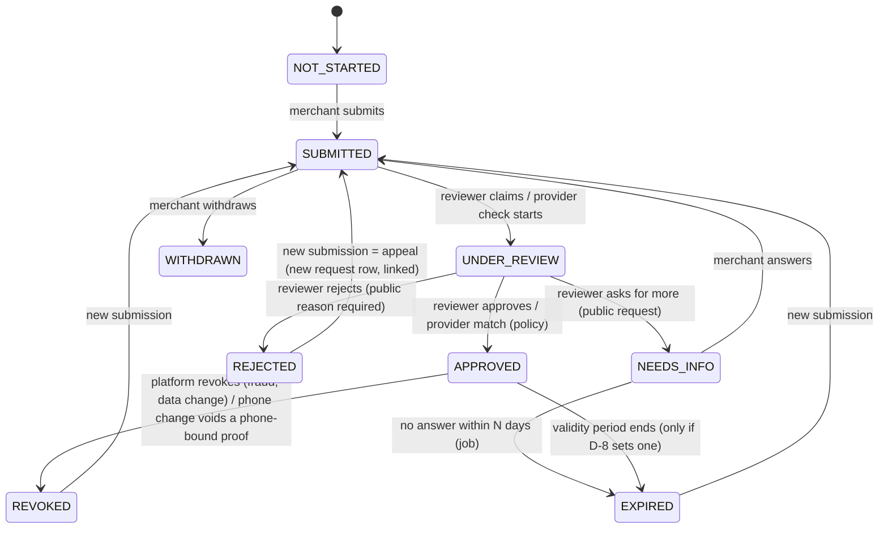

# ADR 0005 — Merchant verification and account trust

* **Status:** Proposed (architecture only, 2026-11-24). Nothing in this document is implemented; no schema, API or UI change was made.
* **Supersedes:** ADR 0003 Part B (staged verification sketch). ADR 0003 Parts A (suspension, implemented) and C (billing) are unchanged.
* **Preserves:** ADR 0004 (Kavenegar only at deployment; development OTP via log; no fixed or development codes in production).
* **Labels:** **[EXISTS]** verified in code · **[PARTIAL]** · **[MISSING]** · **[DECIDE]** owner decision · external-claim status:
  **Confirmed** / **Public, confirm for our use** / **Unverified assumption** / **Needs provider or legal consultation**.
* **External research:** none was performed for this ADR. Every statement about an Iranian provider or regulation below is therefore
  labelled "Public, confirm for our use", "Unverified assumption" or "Needs consultation" — never "Confirmed".

---

## 1. Executive summary

1. **Replace the single L0→L3 ladder with independent verification facts and a computed capability policy.** Phone ownership, a
   person's identity and a business's legal status are different facts about different subjects (account, person, legal entity) with
   different lifetimes. A linear "level" forces false orderings (a company's representative must be a verified person, but a verified
   person does not have a verified company) and makes revocation of one fact ambiguous. Levels survive only as **display names** derived
   from the facts.
2. **Phone verification belongs to `User`; identity to a per-user `IdentityVerification`; business to a `LegalEntity` owned by a user and
   linkable to many stores.** One user with many stores verifies once.
3. **Store capabilities derive from the store OWNER's facts** (the accountable party, the only role that can change payout settings).
   Staff facts never widen a store's capabilities.
4. **Capabilities are a pure function** (same pattern as `storeAvailability` in ADR 0003): `capabilitiesFor(ownerFacts, storeFacts)`.
   Verification never writes publishing, suspension or billing fields, and those never write verification fields.
5. **Before the first real merchant, only phone verification (with SMS account recovery and a payout-change cooldown) is needed.**
   Identity and business verification start as **manual review**, introduced only for the capabilities that need them, after the
   provider and legal questions in §9 are answered.
6. **Biggest risk is not verification but account takeover:** today a stolen merchant password can silently replace the store's bank
   cards and gateway merchant id (money redirection). Phone verification adds a recovery path that SIM swap can abuse, so it must ship
   together with sensitive-change protection (§6.2).

---

## 2. Current architecture assessment (verified in code, commit `c97e302`)

| Area | Status | Facts |
|---|---|---|
| User model | [EXISTS] | `User`: `username` (unique), `name`, `passwordHash` (Argon2), `authVersion`; `email` **deprecated** (U1, nullable, unused) |
| Registration / login | [EXISTS] | `/api/auth/register`, `/login`, `/logout`, `/logout-all`, `/me`, `/change-password`; rate limits per IP and per username (`AUTH_RULES`) |
| Sessions | [EXISTS] | Signed token in a cookie, 7-day max age; `authVersion` bump revokes every token (used by change-password and logout-all) |
| Password reset / account recovery | [MISSING] | `PasswordResetToken` table is **deprecated** (email reset removed with U1); no recovery path at all today |
| Merchant phone | [MISSING] / [PARTIAL] | No phone on `User`. `StoreSmsSetting.merchantPhone` is a per-store, **unverified** notification number (phase 3.6) |
| Phone change flow | [MISSING] | — |
| Two-factor auth | [MISSING] | — |
| OTP | [EXISTS], store-scoped | Shopper sign-in only. `OtpChallenge` has a **required `storeId`** (shopper isolation); codes `randomInt` 6 digits, HMAC-stored, attempts + expiry, rate limits per phone/IP; `OtpSender` port; dev log sender behind `CUSTOMER_OTP_DEV_LOG` (refused outside development/test, tested) |
| SMS abstraction | [EXISTS] | `OtpSender` (customers), `TemplateSender` (notifications), Kavenegar adapter configured from platform settings + encrypted platform secret (ADR 0004) |
| Multi-store | [EXISTS] | `Store.ownerId` (one owner), max 10 stores per user; `StoreMember` roles MANAGER / OPERATOR; invitations |
| Ownership transfer | [MISSING] | No transfer of `Store.ownerId` anywhere |
| Store permissions | [EXISTS] | 16 permissions; `secrets.manage` (gateway credentials) is **OWNER only**; bank cards use `store.settings` (OWNER **and MANAGER**) |
| Platform roles | [EXISTS], coarse | `PlatformAdmin` with a single role `SUPER_ADMIN`; role read from DB per request; first admin by server command |
| Platform admin UI | [EXISTS] | `/platform` overview, stores (with suspension), settings, rates, admins |
| Audit | [EXISTS] | `AuditEvent` (platform rows `storeId = null`, store rows visible to OWNER/MANAGER), 365-day retention |
| Store suspension | [EXISTS] | ADR 0003 G2: independent of publishing; computed availability |
| Account-level restriction | [MISSING] | (ADR 0003 D2: separate, not built) |
| Secrets | [EXISTS] | Envelope encryption (AES-GCM data key wrapped by `SECRETS_MASTER_KEYS`), store and platform secrets, write-only over HTTP |
| Object storage | [EXISTS], **public only** | `MediaStorage` = put / delete / list / exists; one bucket whose policy allows anonymous GET; **no private read, no presigned URLs** |
| Private binary precedent | [EXISTS] | Card-to-card receipts: re-encoded image (EXIF stripped) stored as `bytea` in PostgreSQL, served only through an authorised API route |
| Identity / business verification | [MISSING] | — |

**Security gap found during this review (exists today, independent of verification):** a MANAGER can replace the store's bank cards
(`store.settings`), and the OWNER (or anyone holding the owner's password) can replace the Zarinpal merchant id / Aghaye Pardakht pin.
Neither change is notified, delayed or confirmed. This is the money-redirection path that verification work must close (§6.2, D-3).

---

## 3. Proposed verification model

### 3.1 Facts, not a ladder

| Fact | Subject | How established | Lifetime |
|---|---|---|---|
| **Phone verified** | User | OTP to the phone | Until the phone changes or an admin removes it |
| **Identity verified** | Person (the user) | Provider check and/or manual review | Until revoked; optionally re-checked (decision D-8) |
| **Business verified** | LegalEntity | Manual review (provider lookup later, if available) | Until revoked or the entity's data changes |

**Display levels** (for UI and support only, computed): L0 Registered · L1 Phone verified · L2 Identity verified (requires L1) ·
**Business verified is shown as a badge, not a level** (it requires the representative to be L2, but an L2 person need not have a
business). This resolves "L2 vs L3 are not interchangeable": L3 is not "more than L2", it is a different subject.

### 3.2 Critical assessment of the proposed L0–L3 model

* **L0 → store creation is fine**; blocking creation adds friction with no safety benefit (drafts are private).
* **L1 is weak identity** (cheap SIMs, SIM swap). It is valuable for *reachability and recovery*, not for trust. Do not market it as
  "verified merchant".
* **L2 via mobile ↔ national-ID matching couples identity to the phone.** If identity is proven by matching the current mobile to a
  national code, a phone change invalidates that proof. Manual document review does not have this coupling. The model must record
  *how* identity was established (`method`) so phone changes can invalidate only phone-derived proofs.
* **L3 as a level** is unnecessary complexity for an individual seller (most small Iranian online shops are individuals). It must be
  optional and capability-specific.
* **Missing from the proposal:** account takeover protection, payout-change safety, ownership transfer, and revocation semantics.

---

## 4. Conceptual data model (illustrative only — not added to the repository)

```prisma
// Phone: on the account (one verified phone per account; a phone verified on at most one account - decision D-4)
model User {
  // ...existing
  phone              String?   @db.VarChar(16)   // +989xxxxxxxxx (same CHECK as Customer.phone)
  phoneVerifiedAt    DateTime?                    // null = not verified
  sensitiveLockUntil DateTime?                    // cooldown after recovery / phone change (§6.2)
  // partial unique index: (phone) WHERE phoneVerifiedAt IS NOT NULL
}

// OTP for accounts, separate from shoppers' store-scoped OtpChallenge (keeps shopper isolation CHECKs intact)
model AccountOtpChallenge {
  id         String    @id @default(cuid())
  userId     String?                 // null for recovery started from a phone number
  phone      String    @db.VarChar(16)
  purpose    AccountOtpPurpose       // VERIFY_PHONE | CHANGE_PHONE | RECOVER
  codeHash   String    @db.VarChar(64)
  attempts   Int       @default(0)
  expiresAt  DateTime
  consumedAt DateTime?
  createdAt  DateTime  @default(now())
}

// Identity of the person behind a user account
model IdentityVerification {
  id           String              @id @default(cuid())
  userId       String
  status       VerificationStatus  // §5
  method       IdentityMethod      // MANUAL_DOCUMENTS | PROVIDER_MOBILE_MATCH | PROVIDER_CIVIL_REGISTRY
  legalName    String              @db.VarChar(120)
  nationalIdHmac String            @db.VarChar(64)   // keyed hash: duplicate detection without storing the number in clear
  nationalIdEnc  Bytes?                               // envelope-encrypted, only if a later re-check or invoice needs it (D-7)
  boundPhone   String?             @db.VarChar(16)   // the phone a PROVIDER_MOBILE_MATCH proof was made for
  decidedById  String?
  decidedAt    DateTime?
  expiresAt    DateTime?
  createdAt    DateTime            @default(now())
  // partial unique index: one open (SUBMITTED/UNDER_REVIEW/NEEDS_INFO) request per user; one APPROVED per user
}

// A legal entity (company) represented by a verified person, linkable to many stores
model LegalEntity {
  id              String   @id @default(cuid())
  representativeId String  // User; must hold an APPROVED identity to submit
  legalName       String   @db.VarChar(200)
  nationalIdEnc   Bytes    // company national id (شناسه ملی), envelope-encrypted; + HMAC for uniqueness
  registrationNo  String?  @db.VarChar(40)
  status          VerificationStatus
  // ...decision fields as above
}
model Store { /* ...existing */ legalEntityId String? }  // optional: a store sells as an individual or as an entity

// Private documents (never in the public media bucket)
model VerificationDocument {
  id          String  @id @default(cuid())
  subjectType String  // IDENTITY | LEGAL_ENTITY
  subjectId   String
  kind        String  // NATIONAL_CARD_FRONT | ... (allowlist)
  storageKey  String  // private bucket key, or null when stored in PostgreSQL (D-6)
  sha256      String
  sizeBytes   Int
  deleteAfter DateTime   // retention (D-9)
  createdAt   DateTime @default(now())
}

model VerificationEvent {   // append-only history of every transition and admin action
  id String @id @default(cuid()); subjectType String; subjectId String
  fromStatus VerificationStatus?; toStatus VerificationStatus
  actorId String?; actorKind String  // MERCHANT | PLATFORM | SYSTEM
  publicReason String?               // shown to the merchant
  internalNote String?               // platform only
  createdAt DateTime @default(now())
}
```

**Ownership answers:**
* Phone → **User** (account fact). Identity → **separate entity per user** (person fact with its own workflow and data protection).
  Business → **LegalEntity**, not Store (one company may run several stores; a store may sell as an individual).
* One user, many stores: identity and entities are **shared**; no repeated verification.
* Many users, one store: **the owner's facts decide**. Staff verification is irrelevant to store capabilities. If D-3 keeps bank cards
  editable by MANAGERs, those managers must at least be phone-verified, and every bank-card change notifies the owner.
* Ownership transfer ([MISSING]): when built, capabilities are recomputed from the new owner; payout settings (bank cards, gateway
  credentials) are **cleared or frozen** until the new owner re-confirms them; `legalEntityId` is cleared unless the new owner
  represents that entity.

---

## 5. Workflow and state transitions

Phone verification is **not** a reviewed workflow: it is an OTP proof with timestamps. Identity and legal-entity verification share:



* **Who:** merchant — submit, answer, withdraw (own subject only); reviewer (platform permission) — claim, approve, reject, request
  info, revoke; system — expiry, phone-change revocation of `PROVIDER_MOBILE_MATCH` proofs.
* Transitions are compare-and-set (`UPDATE … WHERE status = expected`), each writes a `VerificationEvent` in the same transaction.
* **One open request per subject** (partial unique index); a duplicate submit returns the open one. Resubmissions/appeals are new rows
  linked to the previous decision; rate-limited (e.g. 3 per 30 days) to bound review cost and document storage.
* A reviewer cannot act on a request where they are the subject or a member of a related store (server-side check, test).

---

## 6. Security and privacy

### 6.1 Phone verification on the existing OTP architecture (ADR 0004)

* Reuse the **domain rules and crypto** (`newCode`, HMAC, attempt and expiry rules, rate limits) and the **`OtpSender` port**; do not
  reuse the `OtpChallenge` table (its `storeId` is the shopper isolation boundary).
* Move `OtpSender` from the customers module to the platform SMS layer (code move, no behaviour change) so both customer and account
  OTP depend on the platform port, not on each other.
* Development delivery: a development-only sender behind a flag refused outside `development`/`test`, with a start-up test, exactly as
  `CUSTOMER_OTP_DEV_LOG` (D-11: separate flag recommended so enabling one never silently enables the other). No fixed codes, no bypass.
* Different Kavenegar template for account codes (purpose shown in the text: verification vs recovery) — configured at deployment only.

### 6.2 Account security and recovery

| Event | Proposed behaviour |
|---|---|
| Phone verification | OTP to the phone; `phoneVerifiedAt` set; audit (platform + account) |
| Phone change | Requires current password **and** OTP to the new phone; old phone gets an SMS notice; `authVersion + 1` except the current session (D-12); sensitive cooldown starts; `PROVIDER_MOBILE_MATCH` identity proofs are revoked (manual proofs stay) |
| Password reset ("forgot password") | Username/phone → OTP to the verified phone → new password → `authVersion + 1` (all sessions out) → cooldown starts → SMS notice |
| Lost phone and password | No self-service. Manual recovery by a platform reviewer **only for identity-verified accounts** (documents compared with the approved identity), audited; otherwise not recoverable (D-10) |
| Change password (signed in) | [EXISTS]; add an SMS notice when a verified phone exists |
| Unverified account without password | Not recoverable (D-10) — this is the honest consequence of no email and no phone |

**Sensitive-change cooldown — evaluated, not adopted blindly.**
* *Benefit:* SIM swap or password theft gives an attacker the account; the money is only reachable by changing **payout settings**
  (bank cards, gateway merchant id / pin) or the phone itself. A delay plus a notice to the old phone gives the real owner time to react.
* *Usability cost:* a legitimate merchant who just recovered access cannot change bank cards for the delay; new merchants are **not**
  affected (the cooldown starts only on recovery or phone change, not on first verification).
* *Scope (recommended):* only payout-affecting actions and the phone itself — bank cards, gateway credentials, phone change, future
  ownership transfer, future payout account. Catalog, orders, publishing are never blocked.
* *Length:* **24 h recommended for launch** (D-2); 48 h is safer but noticeably hurts support load in a market where merchants often
  change SIMs. Platform reviewers can lift it early after a manual check (audited).
* *Independent of verification work but in the same release:* notify the owner on every bank-card or gateway-credential change, and
  decide whether MANAGERs keep `store.settings` over bank cards (D-3; recommended: OWNER only).

### 6.3 Documents and personal data

* **Storage:** the current `MediaStorage` cannot hold private documents safely: one bucket with anonymous GET, no private read API.
  Options (D-6):
  1. **PostgreSQL `bytea`**, envelope-encrypted with the existing secrets scheme, served only through an authorised API route —
     the receipts precedent; simplest; grows DB and backups. Recommended for manual review at small volume.
  2. **A second, private bucket** (separate credentials, no public policy, no public URL), objects envelope-encrypted before upload,
     a new `PrivateStorage` port with `get`; the API streams after authorisation. Better at volume.
  * Presigned URLs are **not recommended** initially: they are bearer links that leak through logs, referrers and screenshots; if used
    later, ≤ 60 s, single object, issued only to reviewers, logged.
* **Processing:** images only at first (re-encode, strip EXIF, size limits — existing pipeline); no PDFs until a sandboxed parser
  decision. Malware-free by construction (re-encoding), not by scanning.
* **Encryption:** in transit (TLS at Caddy, internal network); at rest via envelope encryption (bucket/DB compromise alone is not
  enough); master keys per ADR/D31-3.
* **Minimisation:** national code stored as a keyed HMAC for duplicate detection; the clear value only if a re-check or invoices need
  it (D-7). Merchant-facing answers show masked data (e.g. last 3 digits).
* **Retention (D-9, legal confirmation needed):** documents deleted N days after a final decision (proposal: 90); decision records kept
  per the audit retention; legal holds for fraud cases.
* **Access logging:** every document view by a reviewer writes a platform audit row (who, which document, when). No document content,
  national code or note in logs; logs carry ids only.
* **Abuse:** rate limits on OTP (per phone, IP, account), submissions, document uploads; one verified phone per account; national-code
  HMAC uniqueness flags duplicate identities for review instead of silently allowing them.

### 6.4 Multi-tenant isolation (enforcement points)

* Merchant routes for verification are **account-scoped** (`/me/...`), never take a user id or document id the caller does not own;
  documents are never served by merchant routes after submission (a merchant cannot list or download other users' documents; even their
  own are write-only, like secrets — D-6 detail).
* Status changes exist **only** on platform routes; merchant routes can only submit, answer or withdraw. Architecture test: no
  `stores/:storeId` or `/me` route writes `status`.
* Platform authorisation is server-side per request (existing `PlatformAdminGuard` reading the DB) plus the new permission check; the
  reviewer re-check happens inside the transaction (as suspension does).
* Store suspension, account restriction, billing and verification are separate tables and separate writers; each gate reads all the
  facts it needs (§8).

---

## 7. Platform admin requirements

* **Today:** one role (`SUPER_ADMIN`) can do everything. That is acceptable for suspension, but identity documents are the most
  sensitive data on the platform. **Recommend platform permissions** (D-5) before any document is stored:
  `verification.review` (see queue, decide), `verification.documents` (open documents), `verification.revoke`, separate from settings
  and admin management. Implementation: a `PlatformAdmin.permissions` set or additional roles; the guard checks the permission per
  route. SUPER_ADMIN holds all.
* **Screens:** queue (filters: status, age, subject type), request detail (facts, masked identifiers, document viewer with
  per-view audit), actions (approve / reject with required public reason / request info with a public message / revoke with
  reason), internal notes (platform only), full history (`VerificationEvent`), linked stores and their suspension state (read-only).
* **Self-review prevention**, optional **four-eyes** for revocations of businesses with active payments (D-5).
* **Leak prevention:** merchant DTOs are separate types without internal notes or reviewer identity (same lesson as the G2 review:
  the store audit row must not carry reasons or operator names).

---

## 8. Feature access matrix

Policy = **our product/security recommendation**. Provider and legal columns are questions, not facts.

| Capability | Policy (recommended) | Provider requirement | Legal requirement |
|---|---|---|---|
| Account creation | none | — | — |
| Store creation, drafts, preview | none (L0) | — | — |
| Publishing a store | **phone verified** (owner) | — | Needs consultation (e.g. Samandehi applicability, checklist L5) |
| Cash-on-delivery orders | phone verified (implied by publishing) | — | — |
| Order SMS to the merchant | phone verified (use the verified phone; `StoreSmsSetting.merchantPhone` becomes a default from it) | — | — |
| Online gateway (merchant's own terminal) | phone verified + cooldown rules | **Confirm with Zarinpal / Aghaye Pardakht**: their own merchant KYC is the money-side control; whether they expect store-builder KYC is unknown | Needs consultation (platform's role, checklist L6) |
| Card-to-card | **identity verified (D-1)** or phone verified + a visible limit/warning | n/a (no provider) | Needs consultation (consumer protection) |
| Custom domain | phone verified + domain ownership proof | — | eNamad on that domain is a merchant matter (checklist L4) |
| Torob product feed / connection | phone verified | **Confirm with Torob** (shop registration is per domain; partner terms unknown) | — |
| Other commercial integrations (Emalls, future) | phone verified by default; per integration | Confirm per provider | — |
| Selling as a company (invoices with the entity's name) | business verified | — | Needs consultation (tax / e-invoicing, checklist BL4) |
| Paid subscription | phone verified; invoice details collected at checkout | — | Needs consultation (tax) |

Enforcement: a pure `capabilitiesFor(owner, store)` in `packages/shared`, checked in the service that enables the capability **and**
at the moment of use where money is involved (e.g. card numbers are shown to shoppers only while the owner still holds the
capability; revocation hides them, it does not unpublish the store). Removing a fact never deletes configuration; it disables use.

**Interaction with other governance:** availability (`published ∧ ¬suspended ∧ ¬billing`) decides whether the storefront is live;
capabilities decide what the merchant may enable and which payment methods are offered. Neither writes the other: approving a merchant
never restores a suspended store; restoring a store never approves a merchant; a verification revocation for fraud is accompanied by an
explicit, separate suspension if the store must go offline. Account restriction (future) blocks the account's writes across all its
stores and is its own record.

---

## 9. Iranian market dependencies and unknowns

| Topic | What is believed | Status |
|---|---|---|
| Mobile ↔ national-ID match ("Shahkar", run under the telecom regulator) | A national system that tells whether a mobile number is registered to a national code; private businesses reportedly reach it through licensed intermediaries under contract | **Public, confirm for our use** (who may call it, contract, cost, data-protection terms) |
| Civil registry (ثبت احوال) identity data via intermediaries | Some fintech/KYC companies advertise national-ID + birth-date inquiries | **Unverified assumption**; **needs consultation** on lawful basis and providers |
| Video / selfie KYC providers | Offered by some Iranian fintechs | **Unverified assumption** |
| Company registry (روزنامه رسمی / rrk.ir, ilenc.ir) | Public web lookup of companies by national id / registration number | **Public, confirm for our use** (manual lookup by reviewers is plausible; automated access unknown) |
| eNamad | Issued per domain after the applicant's identity/business checks; a badge page is publicly viewable | Badge existence **Public, confirm for our use**; using an eNamad as evidence of business verification **needs consultation** |
| PSP merchant KYC (Zarinpal, Aghaye Pardakht) | PSPs identify their merchants and settle to the merchant's own bank account | **Public, confirm for our use**; whether a store builder must also verify **needs provider consultation** |
| Legal duty for a store builder to verify merchants | Unknown | **Needs legal consultation** |
| Retention periods for identity documents | Unknown | **Needs legal consultation** |

Practical conclusion: **manual review first** (documents + reviewer, optional public registry lookups by the reviewer), with the data
model ready for a provider method later. No product promise ("instant verification") depends on an unconfirmed provider.

---

## 10. Testing strategy

**Automated (development, CI; no provider, no secrets):**
* Unit: capability policy truth tables; state machine (every allowed and forbidden transition); OTP rules reuse; cooldown math;
  HMAC duplicate detection.
* API/DB integration: phone verify, change, recovery with the development sender and an in-memory fake; `authVersion` bumps; cooldown
  blocks payout changes and not catalog; one open request per subject; compare-and-set races (two reviewers approve at once).
* Authorisation: every verification route × {anonymous, merchant, other merchant, staff, reviewer without permission, super admin};
  self-review refused; merchant cannot change status by any route (architecture test).
* Multi-tenant isolation: another merchant's request/document ids → 404; document routes never reachable from store routes;
  merchant DTOs contain no internal notes, reviewer ids or full identifiers (snapshot tests, as in the G2 audit test).
* Document security: private storage has no anonymous access (storage policy tests like the existing ones); every view audited;
  re-encoding strips metadata; size/type limits; retention job deletes and leaves the decision record.
* Recovery: SIM-swap scenario (recover → cannot change cards for the cooldown → owner notified); lost phone + password → no
  self-service path.
* E2E (Playwright, as in G2 verification): merchant verifies phone with the logged code; submits identity; reviewer requests info,
  merchant answers, reviewer approves; card-to-card becomes available; revocation hides card numbers.
* Start-up tests: every development flag refused outside development/test.

**Real-world (deployment phase only, ADR 0004):** Kavenegar delivery of the account OTP and recovery templates on real phones;
operator latency; any identity provider integration in its sandbox, then a supervised live check.

---

## 11. Rollout strategy

| Phase | Mandatory | Optional / off |
|---|---|---|
| Internal development & testing | nothing (dev sender) | all flows testable with the log sender |
| Internal staging | phone verification for publishing (dev sender or provider sandbox), cooldown, notices | identity review UI with test documents only |
| **First real merchants (pilot)** | phone verified (real SMS once Kavenegar is live at deployment), recovery, cooldown, owner-only payout changes | identity verification **manual**, required only for card-to-card if D-1 says so; business verification off |
| Public launch | as pilot + reviewer permissions (D-5) + document retention job + legal-confirmed policies | business verification for "sell as a company"; provider-based identity only if §9 confirmed |

Grandfathering: existing published stores stay online; owners get a deadline (D-13) to verify the phone before they can publish again
or enable new payment methods. Nothing goes offline automatically because of verification.

---

## 12. Risks and trade-offs

1. **SMS as the recovery factor** enables SIM-swap takeover; mitigated, not eliminated, by cooldown + notices. A second factor (TOTP)
   for owners with payments is the real fix (later).
2. **Identity documents are a breach magnet.** Storing none is safest; manual review needs them. Retention and per-view audit are
   mandatory, not optional.
3. **Manual review cost** scales with merchants (300 stores × appeals). Keep identity verification capability-specific, not global.
4. **Provider-based identity** may be legally or commercially unavailable; the model must not depend on it.
5. **Phone-bound identity proofs** break on phone change by design; reviewers will see re-verifications.
6. **Owner-centric capabilities** ignore well-meaning staff; acceptable because staff cannot change payouts (after D-3).
7. **Not unpublishing on revocation** keeps shoppers' orders working (ADR 0003 D1) but means a revoked fraudster stays online until a
   reviewer also suspends; the admin UI must make that second step obvious.
8. **Complexity:** five new tables. Phase V1 needs only two of them (phone fields + `AccountOtpChallenge`).

---

## 13. Open product decisions (owner approval needed)

| # | Decision | Recommendation |
|---|---|---|
| D-1 | Card-to-card requires identity verification? | Yes for public launch; pilot: phone + manual identity on request |
| D-2 | Cooldown length and scope | 24 h, payout settings + phone only; reviewer may lift early |
| D-3 | Who may change bank cards | OWNER only (today MANAGER too) + owner notified on every change |
| D-4 | Phone uniqueness | One verified phone per account; a phone verified on at most one account |
| D-5 | Platform permissions for reviewers; four-eyes for revocations | Permissions before any document is stored; four-eyes later |
| D-6 | Document storage | PostgreSQL envelope-encrypted for the pilot; private bucket when volume requires |
| D-7 | Store the national code in clear (encrypted) or only as HMAC | HMAC + last 3 digits; encrypted clear value only if a provider re-check or invoices need it |
| D-8 | Identity validity period / periodic re-check | None at launch; revoke on evidence |
| D-9 | Document retention after decision | 90 days, subject to legal confirmation |
| D-10 | Recovery without phone and password | Manual, only for identity-verified accounts |
| D-11 | Development flag for account OTP | Separate `ACCOUNT_OTP_DEV_LOG` (same refusal and test) |
| D-12 | Phone change: sign out other sessions | Yes, keep the current one |
| D-13 | Grandfather deadline for existing published stores | 14 days |
| D-14 | Verified merchant phone replaces `StoreSmsSetting.merchantPhone`? | Use it as the default; keep the per-store override |

---

## 14. Recommended implementation phases

| Phase | Content | Depends on |
|---|---|---|
| **V0 — payout safety (no verification)** | OWNER-only bank cards (D-3), audit + in-app notice on bank-card / gateway-credential changes, `capabilitiesFor` skeleton (all allowed) | D-3 |
| **V1 — phone verification** | `User.phone*`, `AccountOtpChallenge`, verify / change phone, `OtpSender` moved to the platform SMS layer, dev sender flag + start-up test, publishing requires phone (grandfathered) | V0; D-4, D-11, D-12, D-13 |
| **V2 — recovery and cooldown** | Forgot-password by SMS, `authVersion` handling, cooldown on payout changes, SMS notices (dev sender until deployment) | V1; D-2, D-10 |
| **V3 — platform permissions** | Reviewer permissions in `PlatformAdmin`, guard per route, tests | D-5 |
| **V4 — manual identity verification** | `IdentityVerification`, `VerificationEvent`, private document storage, reviewer queue and actions, per-view audit, retention job; card-to-card gated (D-1) | V1, V3; D-1, D-6, D-7, D-9 |
| **V5 — business verification** | `LegalEntity`, store link, reviewer flow | V4 + legal input (§9) |
| **V6 — provider identity (optional)** | Provider adapter behind a port, `PROVIDER_*` methods, phone-bound revocation | §9 confirmations |

**Before the first real merchant:** V0, V1, V2 (and real SMS delivery verified at deployment per ADR 0004). **Before public launch:**
V3, V4 (if D-1 keeps card-to-card gated). V5 and V6 only when their external answers exist.
