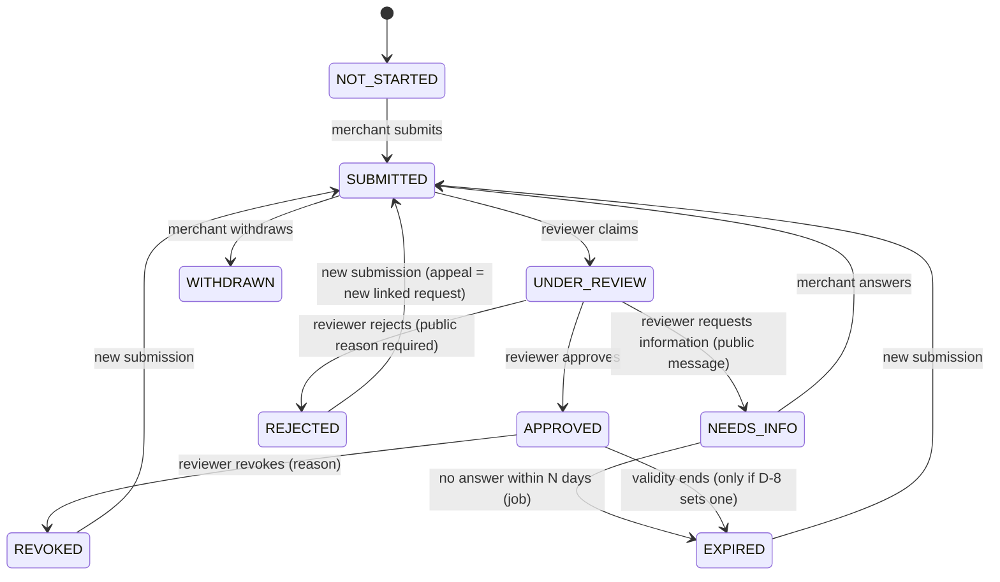
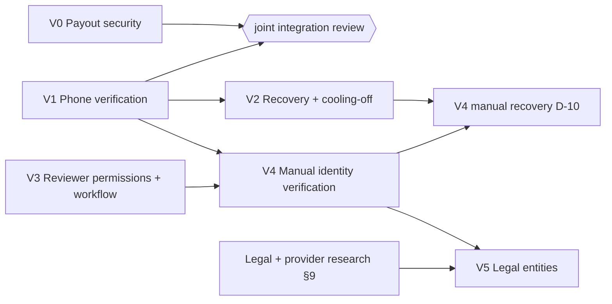

# ADR 0005 — Merchant verification and account trust

* **Status:** Accepted as architecture, 2026-11-24, with the owner's decisions of the same day (§0). **Nothing in this document is
  implemented**; no schema, API, UI or test exists for it. Every database or API change below is an expectation for future work.
* **Supersedes:** ADR 0003 Part B. ADR 0003 Parts A (suspension, implemented) and C (billing) are unchanged.
* **Preserves (unchanged):** ADR 0004 — Kavenegar is activated only in the final production deployment phase; development OTP is
  log-only and refused outside development/test; production never accepts fixed or development codes; real SMS delivery testing is
  deferred to production provider configuration.
* **Labels:** **[EXISTS]** verified in code · **[PARTIAL]** · **[MISSING]** · decision status **Approved** (owner) / **Recommended**
  (architect, needs owner confirmation) / **Pending** (open). External-claim status: **Confirmed** / **Public, confirm for our use** /
  **Unverified assumption** / **Needs provider or legal consultation**.
* **External research:** none was performed. No statement about an Iranian provider or regulation is marked "Confirmed".

---

## 0. Decision register

### 0.1 Approved by the owner (2026-11-24)

| ID | Decision | Consequence in this ADR |
|---|---|---|
| **D-13** | **Grace period for existing stores.** Existing stores never go offline and receive no automatic restriction because their owners have not verified; the grace period is for notices and reminders only. This is **not** a permanent exemption: any future enforcement for existing merchants is a separate product decision (D-17). | §11; V1 builds verification without enforcing it on existing stores |
| **D-10** | **Identity-based manual recovery.** A merchant who lost access to the verified phone may request manual recovery, available **only to identity-verified users**, through a controlled administrative review. Success invalidates every session and notifies the owner through the available verified channels. Users who are **not** identity-verified have **no** manual recovery path and no alternative method (§6.3). | V2 builds self-service recovery; the manual path ships with V4 |
| **D-6** | **Encrypted PostgreSQL storage** for identity documents in the initial implementation; **no private S3 bucket in this phase**. | §6.4 requirements; V4 |
| **D-15** | **V0 (payout security) and V1 (merchant phone verification) proceed in parallel**; their integration is reviewed together; V2 depends on V1. *(The owner's message labelled this "D-14"; the original D-14 is a different question and stays Pending — see §0.4.)* | §14 |

### 0.2 Recommended (architect; needs explicit owner confirmation)

| ID | Recommendation | Status |
|---|---|---|
| **D-3** | Only the store **OWNER** may change bank cards and payment-gateway payout credentials; MANAGER and OPERATOR may not. Every such change is audited and the owner notified. (Today MANAGER can change bank cards through `store.settings`; gateway credentials are already OWNER-only through `secrets.manage`.) | **Recommended — not approved.** V0 audit and notices do not depend on it; the permission change does |
| D-11 | Separate development flag for merchant OTP (`ACCOUNT_OTP_DEV_LOG`, refused outside development/test, start-up test) | Recommended |
| D-12 | On phone change, sign out every other session and keep the current one | Recommended |

### 0.3 Pending (owner decision required)

| ID | Question | Recommendation | Status |
|---|---|---|---|
| **D-1** | Does card-to-card require identity verification? | Yes by public launch; pilot: no gate, manual identity on request | **Pending** |
| **D-2** | Cooling-off duration and scope after recovery / phone change | 24 h; payout settings (bank cards, gateway credentials) + phone only | **Pending** |
| **D-2a** | Who may release a cooling-off early | Reviewer with `verification.recovery` permission, after a recorded check; never the merchant | **Pending** |
| D-4 | Phone uniqueness | One verified phone per account; a phone verified on at most one account | **Pending** |
| **D-5** | Reviewer permissions (and four-eyes for revocations / manual recovery) | Permissions required before any real document is stored; four-eyes for manual recovery | **Pending** |
| D-7 | National code: HMAC only, or also encrypted clear value | HMAC + last 3 digits; encrypted clear value only if a provider re-check or invoices need it | **Pending** |
| D-8 | Identity validity period / periodic re-check | None at launch; revoke on evidence | **Pending** |
| **D-9** | Document retention after a decision | 90 days, subject to legal confirmation; see §6.4 for the backup window | **Pending** (legal input) |
| D-14 | Verified merchant phone replaces `StoreSmsSetting.merchantPhone`? | Default from it; keep the per-store override | **Pending** |
| **D-16** | Onboarding policy for **new** merchants: does publishing require a verified phone? | Yes (phone verification is cheap and gives reachability); enforcement behind a platform switch, off until approved | **Pending** |
| **D-17** | Future enforcement for **existing** merchants after the grace period | Separate decision when V1 data shows adoption; never automatic offline | **Pending** |
| D-18 | Manual recovery when the old phone is lost: which "verified channels" receive the notice | Old phone (if reachable), the newly verified phone, an in-app notice; no email (none exists) | **Pending** |

### 0.4 Inconsistencies found while updating

1. The owner's "D-14 — implementation priority" does not match the original D-14 (merchant notification phone). Recorded as **D-15**;
   the original D-14 stays Pending.
2. D-10 requires identity verification, which only exists after **V4**; V2 depends only on V1. Until V4 ships **no merchant can be
   recovered manually**: a merchant who loses both the phone and the password is unrecoverable (§6.3).
3. D-10 asks to notify "through available verified contact channels", but the platform has **no email** (removed in ADR 0001 U1); the
   only verified channel is the phone that was lost. D-18 decides the notice channels.
4. The original phase list had V6 (provider identity). The approved list ends at V5; provider-based identity is now an optional
   extension of V4, gated by §9 research.
5. The original matrix said "publishing requires phone verified". With D-13 this cannot apply to existing stores; for new merchants it is
   D-16 (Pending).

---

## 1. Executive summary

1. **Independent verification facts, not a ladder.** Phone ownership (account), identity (person) and business status (legal entity)
   are different facts about different subjects. Display levels are derived names only.
2. **Phone verification on `User`; identity per `User` in its own record; business on a separate `LegalEntity`** that a verified
   person represents and that can be linked to several stores. One identity verification covers all of a user's stores.
3. **Store capabilities derive from the store OWNER's facts** through one pure function, like `storeAvailability` (ADR 0003).
4. **Verification, store suspension, billing restriction and account restriction are independent records with independent writers.**
   Approving a merchant never restores a suspended store; restoring a store never approves its owner.
5. **Order of work:** V0 payout security ∥ V1 phone verification → V2 recovery and cooling-off → V3 reviewer permissions and workflow
   → V4 manual identity verification (documents encrypted in PostgreSQL) → V5 legal entities (after legal and provider research).
6. **Existing stores** keep working through a reminder-only grace period (D-13). **New-merchant enforcement** is a separate pending
   decision (D-16).

---

## 2. Current architecture assessment (verified in code at commit `c97e302`)

| Area | Status | Facts |
|---|---|---|
| User model | [EXISTS] | `User`: `username` (unique), `name`, `passwordHash` (Argon2), `authVersion`; `email` **deprecated** (U1, unused) |
| Registration / login | [EXISTS] | `/api/auth/register`, `/login`, `/logout`, `/logout-all`, `/me`, `/change-password`; rate limits per IP and per username |
| Sessions | [EXISTS] | Signed cookie token, 7-day max age; an `authVersion` bump revokes every token |
| Password reset / recovery | [MISSING] | `PasswordResetToken` is deprecated (email reset removed); no recovery path |
| Merchant phone | [MISSING] / [PARTIAL] | No phone on `User`; `StoreSmsSetting.merchantPhone` is a per-store, **unverified** notification number |
| Phone change, two-factor auth, ownership transfer | [MISSING] | — |
| OTP | [EXISTS], shopper-only | `OtpChallenge` (required `storeId`), random 6-digit codes, HMAC-stored, attempts/expiry, rate limits; `OtpSender` port; `CUSTOMER_OTP_DEV_LOG` refused outside development/test (tested) |
| SMS abstraction | [EXISTS] | `OtpSender`, `TemplateSender`; Kavenegar adapter from platform settings + encrypted platform secret (ADR 0004) |
| Multi-store / staff | [EXISTS] | `Store.ownerId`, ≤ 10 stores per user, `StoreMember` MANAGER / OPERATOR |
| Payout-sensitive permissions | [EXISTS] | Bank cards: `PUT /stores/:id/bank-cards` requires `store.settings` (**OWNER and MANAGER**). Gateway credentials: store secrets require `secrets.manage` (**OWNER only**). Neither change is notified or delayed |
| Platform roles / UI | [EXISTS], coarse | Single `SUPER_ADMIN`; `/platform` overview, stores (suspension), settings, rates, admins |
| Audit | [EXISTS] | `AuditEvent` (platform rows `storeId` null; store rows visible to OWNER/MANAGER), 365-day retention |
| Suspension | [EXISTS] | ADR 0003 G2; computed availability |
| Secrets encryption | [EXISTS] | Envelope encryption: AES-256-GCM data key wrapped by `SECRETS_MASTER_KEYS` (env, **not** in the database); `pnpm secrets:rotate` |
| Private binary in PostgreSQL | [EXISTS] precedent | Card-to-card receipt images: re-encoded (EXIF stripped), `bytea`, served only by an authorised route — **not** encrypted at the application level |
| Object storage | [EXISTS], public only | One public-read bucket; no private read API (not used for documents, D-6) |
| Backups | [EXISTS] (scripts) | `pg_dump` daily-capable script, 14-day `RETENTION_DAYS`, off-server copy mandatory (runbook) |
| Verification of identity / business | [MISSING] | — |

---

## 3. Verification model

| Fact | Subject | Established by | Lifetime |
|---|---|---|---|
| Phone verified | `User` | OTP to the phone (V1) | Until the phone changes or a reviewer removes it |
| Identity verified | `User` (person) | Manual document review (V4); provider methods later if §9 allows | Until revoked (D-8) |
| Business verified | `LegalEntity` | Manual review (V5) | Until revoked or the entity's data changes |

Derived display levels: **L0** registered · **L1** phone verified · **L2** identity verified (implies L1 at the time of approval) ·
**business verified** is a badge on a legal entity, not a level. A phone change does **not** revoke a manual (document-based) identity
proof; it does revoke a future phone-bound provider proof.

---

## 4. Conceptual data model (illustrative only — not added to the repository)

```prisma
model User {                                 // V1, V2
  // ...existing
  phone              String?   @db.VarChar(16)   // +989xxxxxxxxx
  phoneVerifiedAt    DateTime?
  sensitiveLockUntil DateTime?                    // V2 cooling-off
  // partial unique index on (phone) WHERE phoneVerifiedAt IS NOT NULL (D-4)
}

model AccountOtpChallenge {                  // V1 (purposes VERIFY_PHONE, CHANGE_PHONE), V2 (RECOVER)
  id String @id @default(cuid()); userId String?; phone String @db.VarChar(16)
  purpose AccountOtpPurpose; codeHash String @db.VarChar(64); attempts Int @default(0)
  expiresAt DateTime; consumedAt DateTime?; createdAt DateTime @default(now())
}                                             // separate from the shopper OtpChallenge (store-scoped isolation)

model PayoutChange {                         // V0 (or AuditEvent rows with a fixed action set; see §14 V0)
  id String @id @default(cuid()); storeId String; actorId String
  kind String  // BANK_CARDS | GATEWAY_CREDENTIAL
  summary Json // masked: last 4 digits / gateway name only, never full values
  createdAt DateTime @default(now())
}

model IdentityVerification {                 // V4
  id String @id @default(cuid()); userId String; status VerificationStatus
  method IdentityMethod                      // MANUAL_DOCUMENTS (V4); PROVIDER_* only after §9
  legalName String @db.VarChar(120); nationalIdHmac String @db.VarChar(64); nationalIdEnc Bytes? // D-7
  decidedById String?; decidedAt DateTime?; createdAt DateTime @default(now())
  // partial unique: one open request per user; one APPROVED per user
}

model VerificationDocument {                 // V4 (D-6: encrypted in PostgreSQL)
  id String @id @default(cuid()); verificationId String; kind String  // allowlist
  keyId String @db.VarChar(32); wrappedKey Bytes; sealed Bytes        // envelope ciphertext of the re-encoded image
  mime String @db.VarChar(20); sizeBytes Int; sha256 String @db.VarChar(64)
  deleteAfter DateTime?; deletedAt DateTime?; createdAt DateTime @default(now())
}

model VerificationEvent {                    // V3/V4: append-only history
  id String @id @default(cuid()); subjectType String; subjectId String
  fromStatus VerificationStatus?; toStatus VerificationStatus
  actorId String?; actorKind String; publicReason String?; internalNote String?; createdAt DateTime @default(now())
}

model RecoveryRequest {                      // V4 (D-10 manual recovery), uses the same workflow states
  id String @id @default(cuid()); userId String; status VerificationStatus
  newPhone String @db.VarChar(16); evidenceVerificationId String?  // documents compared with the approved identity
  createdAt DateTime @default(now())
}

model LegalEntity {                          // V5
  id String @id @default(cuid()); representativeId String; legalName String @db.VarChar(200)
  nationalIdEnc Bytes; nationalIdHmac String @db.VarChar(64); registrationNo String?; status VerificationStatus
}
model Store { /* ...existing */ legalEntityId String? }   // V5, optional
```

* One user, many stores: identity and legal entities are shared.
* Many users, one store: only the **owner's** facts drive capabilities; staff facts never widen them.
* Ownership transfer is not implemented; when it is, capabilities are recomputed from the new owner, payout settings are cleared or
  frozen until the new owner re-confirms them, and `legalEntityId` is cleared unless the new owner represents that entity.

---

## 5. Workflow and state transitions

Phone verification is an OTP proof (no review). Identity, legal-entity and manual-recovery requests share one state machine:



* Merchant: submit, answer, withdraw — own subject only. Reviewer (V3 permission): claim, approve, reject, request information, revoke.
  System: expiry jobs. Compare-and-set transitions; one `VerificationEvent` per transition in the same transaction.
* One open request per subject; duplicates return the open request; resubmissions rate-limited (e.g. 3 per 30 days).
* A reviewer can never act on a request about themself or about a user of a store they belong to (server-side, tested).

---

## 6. Security and privacy

### 6.1 Merchant OTP on the existing architecture (V1, ADR 0004 preserved)

* Reuse the OTP **domain rules and crypto** (random 6-digit code, HMAC storage, attempts, expiry, rate limits) and the **`OtpSender`
  port**; move the port to the platform SMS layer (code move) so customer and account OTP do not depend on each other.
* **Separate table** `AccountOtpChallenge`; the shopper `OtpChallenge` and its store isolation are untouched.
* Development delivery only through a development-only flag refused outside development/test, with a start-up test (D-11). No fixed
  codes, no bypass, no environment-based skip. Kavenegar templates for account codes are configured only at deployment (ADR 0004).

### 6.2 Payout security (V0)

* **Payout settings** are a distinct category from ordinary store settings: bank cards (card-to-card destinations) and gateway payout
  credentials (Zarinpal merchant id, Aghaye Pardakht pin). They decide **where shoppers' money goes**. Ordinary settings (name, colours,
  contact, shipping) do not.
* Required regardless of D-3: an audit row for every payout change (actor, store, kind, masked summary — last 4 digits / gateway name,
  never full values), and an owner notice (in-app now; SMS when V1 provides a verified phone and the provider is live at deployment).
* With D-3 (Recommended, not approved): a dedicated permission (e.g. `payout.manage`, OWNER only) replaces `store.settings` on the
  bank-card route; MANAGER keeps ordinary settings.
* Payout changes are refused while the platform suspends the store (already true: G2 refuses all non-order writes).

### 6.3 Account recovery and cooling-off (V2; manual path V4)

| Situation | Behaviour |
|---|---|
| Forgot password, has the verified phone | Self-service (V2): OTP to the verified phone → new password → `authVersion + 1` (all sessions end) → cooling-off starts (D-2) → notice to the phone |
| Phone change while signed in | Current password + OTP to the new phone → notice to the old phone → other sessions end (D-12) → cooling-off starts |
| Lost the phone, **identity-verified** (D-10) | Manual recovery request (V4): new phone verified by OTP, documents compared by a reviewer with the approved identity, decision by a reviewer with `verification.recovery` (four-eyes if D-5 says so) → `authVersion + 1` → phone replaced → cooling-off starts → notices per D-18 |
| Lost the phone, **not identity-verified** | **No recovery path** (D-10). The account remains locked to its owner's password; if the password is also lost, the account cannot be recovered. Stores keep running for shoppers (order access, ADR 0003 D1); the merchant can register a new account but cannot take over the old stores. No undocumented alternative is offered by support |
| Lost phone and password before V4 exists | Same as "not identity-verified" (inconsistency §0.4-2) |

**Cooling-off (D-2 Pending):** blocks only payout settings and phone change for the duration; never catalog, orders or publishing.
Benefit: a SIM-swap or password thief cannot redirect money immediately and the owner is warned. Cost: a legitimate merchant who just
recovered cannot change bank cards for the period. Exceptions: early release by a reviewer (D-2a), audited. New merchants verifying a
phone for the first time are not affected.

### 6.4 Identity documents in encrypted PostgreSQL (D-6, V4)

Requirements (all must be implemented **and tested** before the first real document is accepted):

1. **Application-level encryption before persistence:** each document is encrypted with a fresh data key (AES-256-GCM) wrapped by the
   platform master key, the same envelope scheme as store secrets, with the document id and verification id as associated data. The
   database stores only `keyId`, `wrappedKey`, `sealed`.
2. **Keys separate from the database:** master keys stay in the server environment (`SECRETS_MASTER_KEYS`), never in the database, in
   database backups or in git; rotation through the existing rotate procedure extended to documents.
3. **Strict authorisation:** decryption happens only in the API, only for a reviewer with `verification.documents` (V3) acting on that
   request; merchants can upload but **never download** documents (write-only, like secrets); shoppers and store staff have no route.
4. **No public URLs:** documents are streamed by an authorised API response with `Cache-Control: no-store`; no presigned links, no
   public bucket, no file path exposure.
5. **Audit on every access:** each view or download writes a platform audit row (reviewer, document id, request id, time). No content,
   national code or note in the audit row.
6. **Validation:** images only (JPEG/PNG/WebP) at first; magic-byte check, decode and **re-encode** (strips EXIF/GPS and embedded
   payloads; the receipts pipeline), pixel and byte limits (e.g. ≤ 2 MB after re-encoding, ≤ 4 documents per request), no PDFs until a
   separate decision.
7. **Retention and deletion (D-9 Pending):** documents get `deleteAfter` when a request reaches a final state; a job overwrites the
   ciphertext and deletes the row; the decision record stays. Deleting the master key version after rotation makes old backups' copies
   unreadable.
8. **Exposure through API, logs, backups, exports:**
   * API: merchant DTOs never contain document bytes, national codes in clear, internal notes or reviewer identity (DTO snapshot tests).
   * Logs: ids only; request bodies of upload routes never logged; error reports scrubbed.
   * Backups: they contain only ciphertext; the backup restore needs the master keys, kept separately. A deleted document survives in
     backups for the backup retention (14 days today) — the effective deletion time is retention + backup window; D-9 must account for it.
   * Exports: support/database exports and `prisma studio` access must exclude the document table (existing studio guard extended);
     restore drills use the encrypted data as is.

**Trade-offs of PostgreSQL storage:** simplest secure option (one store, transactional with the verification record, no new service,
no bucket policy risk); but documents grow the database and every backup (e.g. 300 merchants × 4 images × ~1 MB ≈ 1.2 GB plus appeals),
lengthen backup and restore times, and add load to `pg_dump`. Mitigations: tight size limits, deletion after decision, monitoring of the
table size; a private bucket remains a later option (not in this phase).

### 6.5 Multi-tenant isolation

* Merchant routes are account-scoped (`/me/...`); they never accept another user's id, request id or document id; foreign ids → 404.
* Status changes exist only on platform routes behind the platform guard and the V3 permission, re-checked inside the transaction.
* A merchant cannot approve their own request; a reviewer cannot review themself or users of stores they belong to.
* An unrelated store owner cannot change another store's capabilities: capabilities are computed from the owner's own records.
* Suspension, account restriction, billing and verification are separate tables and writers; each gate reads all the facts it needs.

---

## 7. Platform admin requirements (V3, before any real document)

* Permissions (D-5 Pending): `verification.review` (queue, decide), `verification.documents` (open documents),
  `verification.recovery` (manual recovery, early cooling-off release), `verification.revoke`. SUPER_ADMIN holds all.
  Implementation expectation: a permission set on `PlatformAdmin` or additional roles; the guard checks the permission per route.
* Screens: queue (status, age, subject type), request detail (masked facts, document viewer with per-view audit), actions (approve,
  reject with public reason, request information, revoke with reason), internal notes (platform only), full history, linked stores and
  their suspension state (read-only).
* Leak prevention: separate merchant DTO types; the store audit log never carries reasons, notes or reviewer identity (G2 lesson).

---

## 8. Feature access matrix

| Capability | Existing stores (D-13, Approved) | New merchants (policy) | Status | Provider / legal questions |
|---|---|---|---|---|
| Account, store creation, drafts | allowed | allowed | Recommended | — |
| Publishing | allowed; reminders only | phone verified | D-16 **Pending** | Samandehi applicability: legal consultation |
| Online gateway (own terminal) | allowed | phone verified; payout changes per V0 | Recommended | PSP expectations: provider consultation |
| Card-to-card | allowed | identity verified by public launch | D-1 **Pending** | Consumer protection: legal consultation |
| Custom domain (not built) | — | phone verified + domain proof | Recommended | eNamad per domain: merchant matter, consultation |
| Torob / external feeds (not built) | — | phone verified | Recommended | Torob partner terms: provider consultation |
| Selling as a company | — | business verified (V5) | Recommended | Tax / e-invoicing: legal consultation |
| Payout changes | per V0 (D-3 Recommended) | per V0 | Recommended | — |

Capabilities are computed by a pure function and checked where the capability is enabled **and** where money is involved (e.g. card
numbers shown only while the owner holds the capability). Losing a fact disables use, never deletes configuration, and never unpublishes
a store (suspension is the separate tool for taking a store offline).

---

## 9. Iranian market dependencies and unknowns

| Topic | What is believed | Status |
|---|---|---|
| Mobile ↔ national-ID match ("Shahkar", telecom regulator) | Reachable for businesses through licensed intermediaries under contract | Public, confirm for our use |
| Civil registry identity inquiries via intermediaries | Advertised by some fintech/KYC companies | Unverified assumption; needs consultation |
| Video / selfie KYC providers | Offered by some Iranian fintechs | Unverified assumption |
| Company registry (rrk.ir, ilenc.ir) | Public web lookup of companies | Public, confirm for our use (manual lookup by reviewers plausible) |
| eNamad as business evidence | Issued per domain after the applicant's checks; badge pages public | Needs consultation |
| PSP merchant KYC (Zarinpal, Aghaye Pardakht) | PSPs identify their merchants; settlement to the merchant's own account | Public, confirm for our use; store-builder duties need provider consultation |
| Legal duty for a store builder to verify merchants | Unknown | Needs legal consultation |
| Retention periods for identity documents | Unknown | Needs legal consultation |

---

## 10. Testing strategy (future)

**Automated (development and CI; no provider, no secrets):** capability truth tables; state-machine transitions (allowed and refused);
OTP rule reuse; payout-change authorisation per role (OWNER / MANAGER / OPERATOR / stranger / suspended store); audit rows and owner
notices for payout changes; cooling-off blocks payout changes but not catalog/orders; recovery bumps `authVersion`; manual recovery only
for identity-verified users; authorisation matrix for every verification route; self-review refused; multi-tenant isolation (foreign
ids → 404); DTO snapshot tests (no notes, reviewer ids, full identifiers, document bytes); document encryption round-trip, wrong-key
failure, ciphertext-only in the database, audit on every view, validation limits, retention job; start-up refusal of every
development flag; Playwright E2E for merchant and reviewer flows using the development OTP log.

**Real-world (production deployment phase only, ADR 0004):** Kavenegar delivery of verification, recovery and notice templates on real
phones; any identity provider only after §9 confirmation, in its sandbox first.

---

## 11. Rollout and onboarding policy

| Phase | Existing stores (D-13) | New merchants |
|---|---|---|
| Internal development | — | all flows with the development OTP log |
| Internal staging | — | phone verification exercised; enforcement switch tested on and off |
| First real merchants | reminders to verify; nothing restricted | per D-16 (Pending); V0 payout security active for everyone |
| Public launch | reminders continue; any enforcement only by D-17 | per D-16 and D-1; V3 + V4 live before card-to-card gating |

Existing stores never go offline because of verification. The grace period has no automatic end date; D-17 decides any future step.

---

## 12. Risks and trade-offs

1. SMS recovery enables SIM-swap takeover; cooling-off and notices reduce it; owner two-factor authentication is the real fix (later).
2. Identity documents attract attackers; encryption, write-only uploads, per-view audit and short retention are mandatory.
3. PostgreSQL growth and backup size (§6.4).
4. No recovery for unverified merchants who lose phone and password (D-10 consequence) — support must state this clearly at sign-up.
5. Manual review cost grows with merchants and appeals.
6. Provider-based identity may never be available to us.
7. A revoked fraudulent merchant stays online until a reviewer also suspends the store (by design).
8. V0 ∥ V1 integration risk: notices of V0 need V1's verified phone; payout permission (D-3) and cooling-off (V2) touch the same routes.

---

## 13. Open decisions (owner approval needed)

D-1, D-2, D-2a, D-3 (recommendation), D-4, D-5, D-7, D-8, D-9, D-11 (recommendation), D-12 (recommendation), D-14, D-16, D-17, D-18 —
see §0.2 and §0.3.

---

## 14. Implementation phases



### V0 — Payout security (parallel with V1)
* **Scope:** classify payout settings separately from ordinary settings; audit every bank-card and gateway-credential change with a
  masked summary; owner notice (in-app; SMS once V1 and the provider exist); if D-3 is approved, OWNER-only payout permission.
* **Dependencies:** none for audit and notices; D-3 for the permission change.
* **Expected changes:** possibly a `PayoutChange` table or a fixed set of `AuditEvent` actions; a `payout.manage` permission (D-3);
  bank-card route permission change (D-3); an in-app notification read model; no migration needed if audit rows suffice.
* **Security:** no full card number or credential in audit or notices; changes refused on suspended stores (existing).
* **Tests:** role matrix for payout routes; audit content (masked); notice created for the owner; staff cannot read full values;
  suspended store refusal.
* **Done when:** every payout change is audited and notified; D-3 decided and, if approved, enforced; tests green.
* **Rollback:** permission change is code-only (revert); audit/notice data additive.

### V1 — Merchant phone verification (parallel with V0)
* **Scope:** phone on `User`, verify and change phone, `AccountOtpChallenge`, `OtpSender` moved to the platform SMS layer, development
  flag (D-11), reminders for existing stores (D-13), enforcement switch for new merchants off until D-16.
* **Dependencies:** D-4, D-11, D-12 for final behaviour; ADR 0004.
* **Expected changes:** `User.phone`, `phoneVerifiedAt`; new `AccountOtpChallenge`; routes `/me/phone/challenge`, `/me/phone/verify`,
  `/me/phone/change`; platform setting for the enforcement switch.
* **Security:** codes random and hashed; rate limits per phone/IP/account; enumeration-safe answers; no development behaviour in
  production (start-up test); shopper OTP untouched.
* **Tests:** OTP rules; uniqueness (D-4); change flow notices and session handling; flag refusal; existing stores unaffected.
* **Done when:** a merchant verifies and changes the phone with the development log; switch exists and is off; tests green; real SMS
  explicitly **not** tested (ADR 0004).
* **Rollback:** nullable columns and a new table (expand-only migration with `down.sql`); switch off.

**Joint V0/V1 review:** notice delivery path, permission and route overlap, cooling-off hooks expected by V2.

### V2 — Account recovery and cooling-off (after V1)
* **Scope:** forgot-password by OTP to the verified phone; `authVersion` bump; `sensitiveLockUntil` cooling-off on recovery and phone
  change (D-2); early release by permitted reviewers (D-2a, needs V3 or SUPER_ADMIN until then); notices.
* **Expected changes:** `User.sensitiveLockUntil`; `AccountOtpChallenge` purpose RECOVER; routes `/auth/recovery/challenge`,
  `/auth/recovery/reset`; checks in payout routes.
* **Security:** same answer whether the account or phone exists; rate limits; cooling-off enforced server-side on every payout route.
* **Tests:** recovery happy path and enumeration; sessions revoked; payout change refused during cooling-off, allowed after; catalog not
  blocked; SIM-swap scenario.
* **Done when:** self-service recovery works for phone-verified users; cooling-off enforced; tests green.
* **Rollback:** disable recovery routes (switch); cooling-off column additive.

### V3 — Verification admin permissions and review workflow (before any real document)
* **Scope:** platform permissions (D-5), guard per permission, verification queue/detail/actions UI (without documents), `VerificationEvent`
  history, self-review prevention, four-eyes if decided.
* **Expected changes:** permission storage on `PlatformAdmin`; new platform routes; `VerificationEvent` table.
* **Security:** server-side permission checks inside transactions; internal notes never in merchant DTOs or store audit rows.
* **Tests:** authorisation matrix; self-review; history immutability; DTO snapshots.
* **Done when:** a reviewer without SUPER_ADMIN can act only within granted permissions; tests green.

### V4 — Manual identity verification
* **Scope:** `IdentityVerification`, encrypted `VerificationDocument` in PostgreSQL (D-6), upload (write-only), reviewer viewer with
  per-view audit, retention job (D-9), card-to-card gating (D-1), **manual recovery** (D-10) with `RecoveryRequest`.
* **Dependencies:** V1, V3; V2 for the recovery wiring; D-1, D-5, D-7, D-9, D-18.
* **Gate:** **no real identity document is accepted** until every §6.4 requirement is implemented and tested (encryption, key
  separation, authorisation, no URLs, access audit, validation, retention, log/backup/export protections).
* **Tests:** §10 document security set; recovery only for identity-verified users; sessions revoked and notices sent on recovery.
* **Done when:** the gate is passed and recorded; reviewers can approve/reject with documents; manual recovery works.
* **Rollback:** stop accepting uploads (switch); purge documents with the retention job; tables additive.

### V5 — Business / legal entity verification
* **Scope:** `LegalEntity`, store link, reviewer flow, "sell as a company" capability.
* **Dependencies:** V4; legal and provider research (§9) — **does not start before those answers exist**.
* **Done when:** defined after the research.
